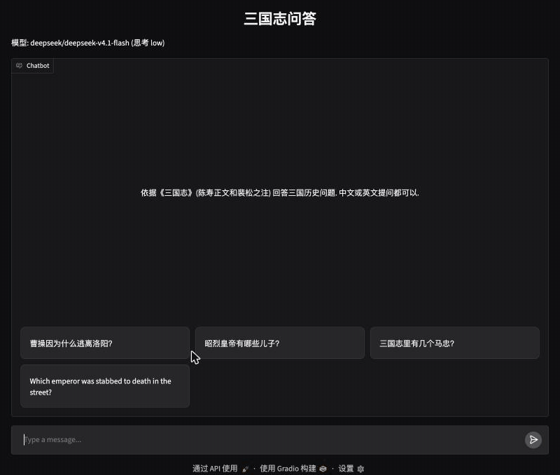
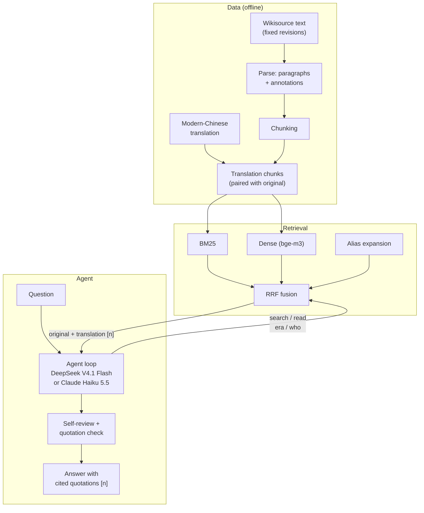

# sanguozhi-rag

English | [中文](README.zh-CN.md)

[](https://github.com/DynHelium/sanguozhi-rag/actions/workflows/tests.yml)
[](https://huggingface.co/spaces/helium-hf/sanguozhi-rag)

Ask questions about Three Kingdoms history in English or Chinese and get answers grounded in Chen Shou's *Records of the
Three Kingdoms* (*Sanguozhi*, 三国志) and Pei Songzhi's annotations (裴松之注). A tool-using agent searches the original
text before it answers, quotes the Classical Chinese with `[n]` citations, and code checks every quotation against the
source character by character.

The repository contains the whole pipeline: parsing and chunking the original text, a full modern-Chinese translation
used for retrieval, hybrid retrieval, the agent, a web chat, two history games, and the evaluation.

**Try it:** [huggingface.co/spaces/helium-hf/sanguozhi-rag](https://huggingface.co/spaces/helium-hf/sanguozhi-rag)
(Claude Haiku 5.5; the games are in Chinese). The demo has a daily spending cap and sleeps when idle, so the first visit
after a quiet period takes about two minutes.



## Features

- **Answers from the source.** The agent decides what to search and read with four tools: `search`, `read` (surrounding
  passages; an annotation comes with the main text it annotates), `who` (whom a name or title refers to, and everyone
  who shares it) and `era` (reign-era year → Common Era year).
- **Search in modern Chinese, quote the original.** Questions are in modern Chinese or English; the text is Classical
  Chinese. Retrieval runs over a modern-Chinese translation of the whole book, combining BM25, dense vectors (bge-m3) and
  alias expansion (a question about 曹操 also finds passages that call him 太祖 or 曹公). The model sees each passage in
  both versions but quotes only the original.
- **Quotation checks in code.** Every 「」 quotation in an answer is matched verbatim against the passages the model saw,
  and the `[n]` after it is checked against the passage that contains it.
- **Two LLM backends.** DeepSeek V4.1 Flash through OpenRouter (default) or Claude Haiku 5.5 through the native Claude
  API, chosen in `.env`.
- **Games.** *Three Kingdoms Turtle Soup* (三国海龟汤), a lateral-thinking puzzle built from passages in the text, and
  *Guess the Person* (猜人物), in which you guess a person the program picked or the agent guesses yours. Both run inside
  the chat; the answer stays in code and a separate judge sees the source passages.

## Quickstart

Requires [uv](https://docs.astral.sh/uv/) and Python ≥ 3.11. Downloading the text and the embedding model needs network
access; asking questions calls the model through OpenRouter or the Claude API and is billed to your key.

```bash
git clone https://github.com/DynHelium/sanguozhi-rag.git && cd sanguozhi-rag
uv sync --extra index --extra ui
uv run python -m ingest.use_wikisource      # download the punctuated text at fixed revisions, parse, chunk
uv run python -m ingest.trans_chunks        # pair each chunk with its modern-Chinese translation
uv run python -m rag.dense --trans          # encode the translation chunks with bge-m3 (about 2.3 GB download, ~7 min)

cp .env.example .env                        # put your OpenRouter key in LLM_API_KEY
uv run python -m app.chat --model deepseek-v4.1-flash --effort low   # open http://localhost:7860
```

One question from the command line:

```bash
uv run python -m rag.agent "Is the Oath of the Peach Garden real?" --model deepseek-v4.1-flash --effort low
```

To use Claude Haiku 5.5, run `uv sync --extra anthropic` and set `LLM_BACKEND=anthropic`, `LLM_MODEL=claude-haiku-5-5`,
`LLM_REASONING_EFFORT=medium` and `ANTHROPIC_API_KEY` in `.env` (the lines are in `.env.example`).

Retrieval alone, without an LLM or the embedding model:

```bash
uv sync && uv run python -m ingest.use_wikisource
uv run python -m rag.retrieve "关羽刮骨疗毒" --bm25
```

Tests make no LLM calls: `uv run python -m tests`. They run on Linux, macOS and Windows in GitHub Actions.

## How it works



The agent loop calls the model, runs the tools it asks for and sends the results back until it answers; the last
request carries no tools, so the round limit holds. Around the loop, code asks the model to search again when it
answered after too few searches or said the text has no record of something, runs one self-review of the answer, and
checks the quotations. Instructions from the code are sent as `developer` messages (system messages in the Claude API),
never as the user. Design decisions and their reasons: [docs/DESIGN.md](docs/DESIGN.md) (in Chinese).

## Evaluation

**Retrieval.** 48 questions with gold passages; hit@k counts a hit when a chunk containing the answer passage is among
the top k (loose: an annotation attached to it also counts).

| Retriever | hit@1 | hit@5 | hit@10 | MRR |
|---|---|---|---|---|
| BM25 over the original text | 0.25 | 0.31 | 0.40 | 0.28 |
| BM25 + dense + alias expansion, original text | 0.31 | 0.60 | 0.69 | 0.43 |
| BM25 + dense + alias expansion, translation (used by the agent) | 0.52 | 0.67 | 0.81 | 0.59 |

On 37 held-out questions the agent's retriever reaches hit@10 0.97 (BM25 over the original text: 0.78).

**What retrieval adds to the answers.** 50 questions, each asked in Chinese and in English, answered by each model in
five setups. The first four share one minimal prompt (answer from the *Sanguozhi*, state facts, say when unsure) and
differ only in what material the model gets; the last is the configuration the web chat uses:

| Setup | DeepSeek, Chinese | DeepSeek, English | Haiku, Chinese | Haiku, English |
|---|---|---|---|---|
| Closed-book (no tools, no passages) | 41 | 43 | 22 | 27 |
| Retrieve once, top 10 passages in the context | 47 | 41 | 43 | 32 |
| Gold passages in the context (upper bound) | 50 | 49 | 49 | 43 |
| Agent with tools only, no code interventions | 44 | 44 | 41 | 40 |
| **The deployed configuration** (full prompt and interventions) | **49** | **50** | **47** | **44** |

Fully correct answers out of 50. The deployed configuration beats closed-book on all four columns (95% confidence
intervals by paired bootstrap over questions exclude zero). Haiku gains the most: closed-book it gets 15 of 50 wrong in
each language, and 23 of its 100 answers invent or misattribute a quotation or source. Retrieving once with the English question
helps little, because the index is in Chinese; the agent translates names and terms before it searches.

Answers are judged only on the facts they state, against a checklist of required points written for each question
before the runs (relabelled once after the first round of judging); a fabricated quotation or record, or a fact that contradicts the text, lowers the verdict. The judge is
an LLM (Claude Sonnet) that searches the original text. Method, full results and per-question verdicts:
[docs/EVALUATION.md](docs/EVALUATION.md) (in Chinese) and the
[`eval-judging`](https://github.com/DynHelium/sanguozhi-rag/tree/eval-judging) branch.

## Repository layout

| Path | Contents |
|---|---|
| `ingest/` | Download and parse the Wikisource text, translation chunks, reign-era table |
| `rag/` | Chunking, BM25, dense retrieval, fusion, aliases, tools (`library.py`), agent loop and agent, LLM backends, games |
| `app/` | Gradio web chat (`chat.py`) and the standalone Turtle Soup page (`soup.py`) |
| `skills/` | Game descriptions for the chat (`SKILL.md`) |
| `eval/` | Retrieval and answer evaluation scripts, question sets |
| `data/` | Unpunctuated text, translation, alias and era tables, puzzle bank |
| `tests/` | Unit tests (no network, no LLM) |
| `docs/` | Design notes, evaluation, deployment |

## Limitations

- Answers draw only on the *Sanguozhi* and Pei Songzhi's annotations; other histories and later scholarship are out of
  scope. The scope is set in the prompt, not enforced by code.
- The modern-Chinese translation was produced by an LLM and proofread only against the original, so it contains errors.
  It is used for retrieval and to help the model read; quotations always use the original.
- The quotation check proves only that a quoted passage exists and is cited correctly, not that paraphrases and
  interpretations are right.
- The evaluation is small (50 questions, one run per setup) and judged by an LLM; differences of a few questions are
  within noise.

## Data and licenses

- The full text in this repository is **unpunctuated** (`data/sources/sanguozhi/baiwen.jsonl`). The *Sanguozhi* and
  Pei Songzhi's annotations are in the public domain, but the punctuation in the Wikisource transcription follows the
  Zhonghua Book Company (中华书局) critical edition, so `ingest.use_wikisource` downloads the punctuated text from
  Wikisource at fixed revisions instead.
- Code: MIT ([LICENSE](LICENSE)). Data under `data/`, the question sets and the evaluation results: CC BY-SA 4.0
  ([LICENSE-DATA](LICENSE-DATA), in Chinese, lists the files and sources).

## Acknowledgments

The text comes from [Chinese Wikisource](https://zh.wikisource.org/wiki/三國志). Retrieval uses
[bge-m3](https://huggingface.co/BAAI/bge-m3) by BAAI, and the web chat is built with [Gradio](https://www.gradio.app/).
