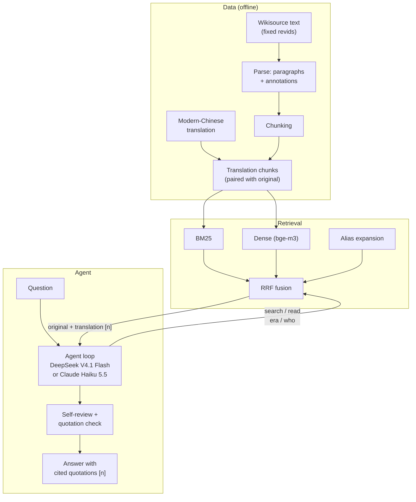
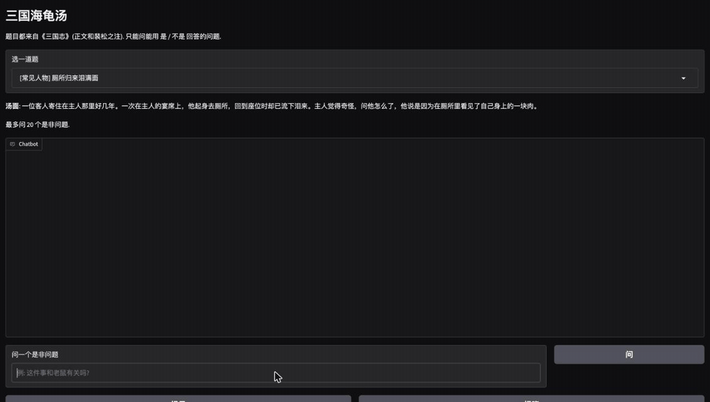

# sanguozhi-rag — Evidence-grounded Three Kingdoms Q&A

English | [中文](README.zh-CN.md)

[](https://github.com/DynHelium/sanguozhi-rag/actions/workflows/tests.yml)

**TL;DR** — Agentic RAG over a 3rd-century Classical Chinese history. Questions come in modern Chinese or English, the corpus
is Classical Chinese, so the two share little vocabulary. Indexing an LLM-made modern-Chinese translation (document expansion)
with hybrid BM25 + dense retrieval and alias expansion lifts hit@10 from 0.40 to 0.81 on the development questions (0.78 → 0.97
on held-out ones). Against baselines with the same model on the same 103 questions: closed-book 61 fully correct (with
unsupported claims in 37 answers), one-shot retrieval 79, the agent 101; on the same 103 questions asked in English 71 / 36 / 99. Every
quotation in an answer is checked against the source text by code.

A RAG project that answers questions about Three Kingdoms history from Chen Shou's *Records of the Three Kingdoms*
(*Sanguozhi*, 三国志) together with Pei Songzhi's annotations (裴松之注). A tool-using agent searches the original text
itself before answering. The model is asked to support facts with quotations from the original text, cited as `[n]`,
and code checks every quotation it finds in the answer character by character.

The whole pipeline lives in this repository: data preparation (parsing the original text, chunking, a full modern-Chinese
translation of the book), hybrid retrieval, the tool-calling agent, evaluation, a web chat UI, and history-based
games: "Three Kingdoms Turtle Soup" (三国海龟汤) and "Guess the Person" (猜人物).

Two LLM backends are supported: **DeepSeek V4.1 Flash** via OpenRouter (the default, reasoning effort low) and
**Claude Haiku 5.5** through the native Claude API (`LLM_BACKEND=anthropic`, reasoning effort medium); the comparison is
under [Two backends](#two-backends). Retrieval runs over the modern-Chinese
translation, while the prompt asks the model to quote only the original Classical Chinese text, and code checks the
quotations it finds against it.

## What's included

Main parts:

- **Data and retrieval**
  - Download and parsing of the original text: Wikisource wikitext → paragraphs + Pei Songzhi's annotations (`ingest/`)
  - Chunking (`rag/chunk.py`): main text and annotations become separate chunks; each annotation chunk points back to the
    main-text passage it annotates
  - Retrieval: BM25 (character bigrams, `rag/bm25.py`), dense vectors (bge-m3, `rag/dense.py`), RRF fusion
    (`rag/fusion.py`), and query-side alias expansion (`rag/alias.py` + `data/aliases.json`, so a question about 曹操
    (Cao Cao) also finds passages that call him 魏太祖 or 曹公)
  - Retrieval evaluation: 49 questions (48 with gold passages scored by hit@k / MRR, plus 1 with no answer in the text;
    `eval/run_retrieval.py`)
- **Full modern-Chinese translation** (`data/processed/translations/`, 65 volumes): translated and proofread paragraph by
  paragraph by an LLM against the original text only, without consulting any modern translation. Retrieval searches the
  translation (`ingest/trans_chunks.py` pairs each original chunk with its translation); the model is still shown the
  original text plus the translation.
- **Data queries behind the tools** (`rag/library.py`): the agent's four tools, `search` (retrieval), `read` (surrounding
  context; an annotation comes with the main text it annotates), `era` (converts a reign-era year to the Common Era year)
  and `who` (whom a name or title refers to, and how many people share it), plus the `[n]` source numbers shown to the model.
- **LLM access** (`rag/llm.py`): an OpenAI-compatible interface that returns the full response (tool calls are read from
  `tool_calls`). With `LLM_BACKEND=anthropic` the same call goes to `rag/claude_llm.py`, which talks to the Claude
  Messages API through the Anthropic SDK (optional extra `anthropic`) and returns a response of the same shape, so the
  agent, the games, the web chat and the evaluation scripts run unchanged. It sends back the model's thinking blocks with
  each tool call, keeps the history append-only so prompt caching works, and passes the reasoning effort through.
  - Request wrapper shared by every entry point (`rag/calls.py`): checks at startup that the key for the backend in
    `.env` is set and that the model matches it (a `claude-*` model needs `LLM_BACKEND=anthropic`), retries with backoff
    when rate-limited (except a 429 from the Claude API saying its spend cap is reached), and records tokens and cost. On OpenRouter it asks
    for the cost in each response and uses only the providers listed in `LLM_PROVIDERS`. The backend is chosen only in
    `.env`; local models (pointing the OpenAI-compatible interface at Ollama and the like) are not supported for now.
- **Agent loop** (`rag/loop.py`): call the model → run the tools it asks for → send the results back as `tool` messages →
  call the model again, until it answers. The round limit is enforced in code (the last request carries no tools). The
  appendix `eval/tool_calling.py` is an early single-tool experiment on whether small local models use the tools
  interface reliably (its live run needs a local model and does not work for now; its fake-model tests do).
- **Full agent** (`rag/agent.py`): the model decides what to search and read; the code does no retrieval up front. The
  system prompt asks for three kinds of content, written separately: facts taken from retrieved original text (quoted,
  with a `[n]` number); inferences marked "据此推断" ("inferred from this") together with their basis; plot points from
  the novel *Romance of the Three Kingdoms* (三国演义) and modern equivalents of place names in a final paragraph labeled
  as not being records of the *Sanguozhi*. The code handles the round limit, a nudge to search more when too little was
  retrieved, a self-review after answering, verbatim quotation checks, and citation-number checks. Quotations that fail
  the check are flagged, but the code cannot guarantee that every fact in an answer has a source.
- **Agent evaluation** (`eval/run_agent.py`): 40 held-out questions (`eval/questions-holdout.jsonl`),
  a new set of 30 questions on inference / the novel / official titles and geography (`eval/questions-reason.jsonl`,
  with reference answers), 24 questions on fact-level errors (`eval/questions-facts.jsonl`) and 9 questions on people
  (`eval/questions-persons.jsonl`). Runs record which original passages the model saw and the time per question.
- **Web chat** (`app/chat.py`, Gradio): multi-turn conversation that shows the retrieval steps live while answering, and
  lists the cited original text, its translation and the quotation-check results below each answer.
- **Three Kingdoms Turtle Soup** (`rag/soup.py`, `app/soup.py`): a reasoning game with puzzles taken from the original
  text; see below.
- **Games in the chat** (`rag/skills.py`, `skills/*/SKILL.md`): the games are skills of the Q&A agent: it has
  `start_game` / `end_game` tools and starts a game when you ask for one in your own words (the buttons start one directly).
  While a game runs, messages go to the game first; anything the game judges is not part of it goes back to the agent. Guess the Person
  (`rag/guess.py`) is described below.

Design and rationale: [docs/DESIGN.md](docs/DESIGN.md) (in Chinese). Deploying the web demo: [docs/DEPLOY.md](docs/DEPLOY.md) (in Chinese).

## Demo

![Web chat, three turns in English: which emperor was stabbed to death in the street, who stabbed him, and why the emperor attacked Sima Zhao himself; the retrieval steps appear live and the answers quote the original text with [n] citations (UI labels are in Chinese)](docs/images/chat-en.gif)

Another example, from the command line:

```bash
uv run python -m rag.agent "桃园结义是真的吗？刘关张在正史里是什么关系？" --model deepseek-v4.1-flash --effort low
```

The question asks: "Is the Oath of the Peach Garden real? What was the relationship between Liu Bei, Guan Yu and Zhang Fei
in the official history?"

The trace below shows the model searching on its own first (its tool calls, marked `[model]`): three `search` calls with
different queries and one `read` to pull the context around an annotation chunk. `[code] review({}) -> []` is the
self-review step that the code triggers after the draft (one more model request). The answer then states the conclusion, quotes the original text with
`[n]` source numbers, gives an inference marked "据此推断" ("inferred from this"), and ends with a paragraph labeled as not
being a *Sanguozhi* record (the Peach Garden oath comes from the novel). The lines at the bottom are the code's check of
each quotation (✓ = found verbatim in the original text, with the chunk id it was found in):

```
[model] search({"query": "刘备 关羽 张飞 关系 情同兄弟"}) -> ['36-0000', '36-0006', ...]
[model] search({"query": "关羽 张飞 跟随刘备 侍立 终日"}) -> ['36-0000', '36-0006', ...]
[model] read({"chunk_id": "36-0000n0"}) -> ['36-0000', '36-0000n0', '36-0000n1']
[model] search({"query": "刘备 关羽 张飞 结拜 兄弟 桃园"}) -> ['36-0000', '36-0006', ...]
[code] review({}) -> []

结论：所谓"桃园结义"在《三国志》里没有找到相关记载，这是《三国演义》的说法。但正史里刘关张三人确实"恩若兄弟"……

「先主與二人寢則同床，恩若兄弟。」[1]
「張飛字益德，涿郡人也，少與關羽俱事先主。羽年長數歲，飛兄事之。」[2]
「吾極知曹公待我厚，然吾受劉將軍厚恩，誓以共死，不可背之。」[9]
……
据此推断：……正史中的三人关系亲密到"恩若兄弟"、患难与共、生死相托的程度，实质上是兄弟兼君臣的关系。……

以下不是《三国志》的记载：桃园结义是《三国演义》的说法。
  ✓ 36-0000  「先主與二人寢則同床，恩若兄弟。」
  ✓ 36-0006  「張飛字益德，涿郡人也，少與關羽俱事先主。羽年長數歲，飛兄事之。」
  ...
```

(Excerpt; the model's searches and wording differ from run to run.)

Quotations always stay in Classical Chinese, because that is what the code verifies. For orientation only, an English
gloss of the first quotation (a gloss, not a verified quotation): "The Former Lord [Liu Bei] slept in the same bed as the
two of them, and treated them with the kindness of brothers."

## Quickstart

Requires [uv](https://docs.astral.sh/uv/) and Python ≥ 3.11. Downloading the text and the embedding model needs network
access, and asking questions calls the model through OpenRouter or the Claude API, which is billed to your key. Start with a route that
needs no large downloads:

```bash
git clone https://github.com/DynHelium/sanguozhi-rag.git && cd sanguozhi-rag
uv sync                                          # base dependencies
uv run python -m ingest.use_wikisource           # download the punctuated Wikisource text at fixed revids, parse, chunk
uv run python -m rag.retrieve "关羽刮骨疗毒" --bm25   # run one query: print the source and text of the top 5 chunks
uv run python -m eval.run_retrieval -r bm25      # BM25 retrieval evaluation
```

Output of `rag.retrieve` (per chunk: rank, volume and section title, main text or annotation, chunk id, original text;
only the start of the first chunk is shown):

```
[1] 蜀書六 關張馬黃趙傳·關羽 正文 (36-0003)
    羽嘗為流矢所中，貫其左臂，後創雖愈，每至陰雨，骨常疼痛，醫曰：「矢鏃有毒，毒入於骨，當破臂作創，刮骨去毒……
```

Next, add dense retrieval (downloads bge-m3, about 2.3 GB):

```bash
uv sync --extra index
uv run python -m rag.dense                       # encode the whole book, cached in data/index/ (about 5 minutes on Apple Silicon)
uv run python -m rag.retrieve "曹操因为什么逃离洛阳？"            # BM25 + dense + alias expansion
uv run python -m eval.run_retrieval -r hybrid --alias route2           # add --strict for the strict metric

uv run python -m ingest.trans_chunks             # translation retrieval chunks (each original chunk paired with its translation)
uv run python -m rag.dense --trans               # encode the translation chunks (about 7 minutes)
uv run python -m eval.run_retrieval -r hybrid --index trans --alias route2   # search the translation
```

Connecting the LLM: `cp .env.example .env`, put your OpenRouter key in `LLM_API_KEY`, then run `uv run python -m rag.llm`
to send one message and check the connection. Web chat (needs the translation index above and `.env`):

```bash
uv sync --extra index --extra ui
uv run python -m app.chat --model deepseek-v4.1-flash --effort low   # open http://localhost:7860
```

To use Claude Haiku 5.5 instead, `uv sync --extra anthropic`, then in `.env` set `LLM_BACKEND=anthropic`,
`LLM_MODEL=claude-haiku-5-5`, `LLM_REASONING_EFFORT=medium` and `ANTHROPIC_API_KEY` (the lines are in `.env.example`).
Every command reads the backend from `.env`, so the commands stay the same apart from the model name:

```bash
uv sync --extra index --extra ui --extra anthropic
uv run python -m app.chat --model claude-haiku-5-5 --effort medium
```

Tests make no LLM calls and need no network: `uv run python -m tests` runs them all (the one case in `test_dense` that uses
the real bge-m3 model needs `uv sync --extra index` and the bge-m3 model already on disk, which one run of `rag.dense`
takes care of, or `ALLOW_MODEL_DOWNLOAD=1` to let the test download it; otherwise it is skipped). GitHub Actions runs
the same tests on Linux / macOS / Windows.

## How it works



Search in modern Chinese, quote in the original: the translation helps the model find passages and understand the
Classical Chinese. The prompt asks the model to quote only the original text; code checks the quotations it extracts
from the answer verbatim and flags those that fail, but it does not guarantee that every fact has a source.

## Evaluation

### Retrieval

48 retrieval questions with gold passages (the 49th has no answer in the text), searched over the original text.
hit@k: whether a chunk containing the answer passage is among the top k. Two metrics: **loose** also counts an annotation attached to the answer passage as a hit; **strict** counts
only the answer passage itself.

| Retriever | hit@1 | hit@5 | hit@10 | MRR |
|---|---|---|---|---|
| BM25 | 0.25 / 0.23 | 0.31 / 0.29 | 0.40 / 0.35 | 0.28 / 0.26 |
| BM25 + dense (RRF) | 0.31 / 0.27 | 0.54 / 0.50 | 0.65 / 0.60 | 0.42 / 0.38 |
| + alias expansion | 0.31 / 0.27 | 0.60 / 0.56 | 0.69 / 0.65 | 0.43 / 0.39 |
| Search the translation: BM25 | 0.40 / 0.40 | 0.60 / 0.56 | 0.62 / 0.58 | 0.49 / 0.46 |
| Search the translation: BM25 + dense + alias expansion (used by the agent) | 0.52 / 0.48 | 0.67 / 0.62 | 0.81 / 0.75 | 0.59 / 0.54 |

(Loose / strict.) The main difficulty is matching modern-Chinese questions against Classical Chinese text: for the query
"曹操因为什么逃离洛阳" ("Why did Cao Cao flee Luoyang?") above, the original text calls him "太祖", so BM25 cannot find
it. The translation is in modern Chinese, and its wording and date formats are close to how questions are asked
("薨" → "去世" (died), "七年" → "建安七年" (7th year of Jian'an)), so searching the translation works much better; titles
for the same person (太祖, 曹公, 魏武) are handled by alias expansion. The query stop-word list was chosen with these 48
questions in view, so they count as a development set.

As a test set, the 37 held-out questions that have gold passages (`eval/questions-holdout.jsonl`, never used for tuning)
give hit@10 0.78 for BM25 over the original text and 0.97 for the agent's retriever (MRR 0.62 → 0.91; loose; strict 0.76 / 0.61
for BM25, unchanged for the agent's retriever). Searching the English questions directly (`eval/questions-en.jsonl`, 100 with gold passages) gives hit@10 0.39 (loose; strict 0.36):
the index is Chinese, which is why the agent translates names and terms back into Chinese before it searches.

### Answer quality

Five configurations, all DeepSeek V4.1 Flash (reasoning effort low), one run each (an empty answer was retried up to
three times), on the same 103 Chinese questions (held-out 40; inference / the novel / official titles and geography 30;
fact-level errors 24; people 9) and the same 103 questions rewritten in English (`eval/questions-en.jsonl`; names in pinyin,
Wade-Giles for about a fifth, English official titles and event names):

| Configuration | Script | Correct / partial / wrong (103) | English correct (103) | Answers with a confident claim not found in the source (103) | Quotations found in the passages the model saw (103) | Model calls per question | Cost per question |
|---|---|---|---|---|---|---|---|
| Closed-book: no tools, no context, a short prompt that allows answering from memory | `eval/run_closed.py` | 61 / 33 / 9 | 71 | 37 | not checked (no passages) | 1 | $0.0037 |
| Same prompt as the next row, but the context says "no material" | `eval/run_single.py --no-context` | 6 / 10 / 87 | 10 | 0 | 0 / 18 (0%) | 1 | $0.0008 |
| One-shot retrieval: the question itself is searched once, top 10 groups in the context, one answer | `eval/run_single.py` | 79 / 17 / 7 | 36 | 0 | 590 / 607 (97.2%) | 1 | $0.0024 |
| Agent with code interventions off (no self-review, quotation fix, citation fix, search nudge) | `eval/run_agent.py --off ...` | 101 / 2 / 0 | 98 | 2 | 764 / 854 (89.5%) | 3.5 | $0.0036 |
| **Agent (default)** | `eval/run_agent.py` | **101 / 2 / 0** | **99** | **1** | **1202 / 1202 (100%)** | 4.7 | $0.0081 |

An older set of 20 English questions (`eval/questions-en-dev.jsonl`) was used while writing the English rule in the prompt,
so it is reported apart: closed-book 18, one search 9, the agent 19 of 20 correct.

"A confident claim not found in the source" is the judge's list of specific facts (years, names, quotations, sources)
stated as fact that it could not find in the text; without material the model mostly says it has none, hence 0 in the
second row.

What the rows separate:

- **Rules alone do not answer questions; retrieved text does.** With the same prompt, no material gives 6 correct and
  one search gives 79. The closed-book prompt does let the model answer from memory (61 correct; the main text appears to
  be in the model's training data),
  but 37 of its answers contain quotations, sources or details that cannot be found in the text.
- **Accuracy comes from the agent's searching.** Between one-shot retrieval and the agent with interventions off, the
  model writes its own queries, searches again, reads the surrounding passages and converts reign years with a tool. The
  gold passage is in the context for 86 of 100 answerable questions with one search and for all 100 with the agent; on
  English questions one search uses the English wording (gold passage in the context for 36 of 100) and gets 36 / 103,
  while the agent translates names and terms back into Chinese first (99 / 103).
- **The code interventions buy quotation accuracy, not correctness.** Turning them off leaves accuracy unchanged on these
  sets, but only 89.5% of quotations are then found in the passages the model saw; with them every quotation checks out.
  They roughly double the cost per question.

Per question set, the default agent gets 39 / 1 / 0 on the held-out set, 30 / 0 / 0 on the reasoning set, 23 / 1 / 0
on the fact-level set and 9 / 0 / 0 on people. One question takes 34.5 s at the median (36.8 s mean; 10 held-out
questions run one at a time with `eval.bench_latency`): about a third is the search loop and the rest is the self-review
after the answer. 5 closed-book questions got no answer in three attempts (reasoning used up the 8192-token output
limit) and count as wrong.

### Two backends

The same agent, prompt and tools with Claude Haiku 5.5 (native Claude API) and with DeepSeek V4.1 Flash, on 62 questions
(`eval/questions-probe62.jsonl`: the 40 held-out questions, 18 English questions and 4 new ones), one run each, all five
runs judged blind in one package:

| Backend | Reasoning effort | Correct / partial / wrong (62) | Chinese correct (44) | English correct (18) | Tool calls per question | Cost per question |
|---|---|---|---|---|---|---|
| Claude Haiku 5.5, before the three changes below | low | 58 / 3 / 1 | 41 | 17 | 2.8 | $0.0042 |
| Claude Haiku 5.5 | low | 56 / 4 / 2 | 39 | 17 | 3.1 | $0.0050 |
| **Claude Haiku 5.5** | **medium** | **60 / 1 / 1** | 42 | 18 | 3.6 | $0.0056 |
| Claude Haiku 5.5 | high | 58 / 1 / 3 | 41 | 17 | 4.2 | $0.0076 |
| **DeepSeek V4.1 Flash** | **low** | **62 / 0 / 0** | 44 | 18 | 4.5 | $0.0069 |

The three changes, made for both backends after the main comparison above: a question asking for a list or a count
("which people", "how many") needs three searches before the first answer instead of two; pinyin names in an English
question are looked up with `who` by code before the model starts; and Classical Chinese inside “…” is checked like a
「」 quotation. On Haiku they did not raise accuracy (56 vs 58 at low, a difference a single run cannot separate from noise): its
misses are answers that stop at the first person found even after more searches (the second 张松, 苏则 for 刚侯), not
too few searches. DeepSeek had no new error with them. Medium effort gave Haiku four more correct answers than low for
about 12% more cost; high was not better. One question Haiku missed at every effort after the changes: who the "White Horse General" was
(庞德, 18-0022), which it said the text does not mention.

English, 21 questions (the 18 above plus the three pinyin homonyms Zhou Tai, Liu Yan, Zhang Yi), with the final prompt:
Haiku (medium) 19 / 1 / 1 and DeepSeek 21 / 0 / 0. Haiku named every person sharing the pinyin for two of the three
homonym questions; the pinyin lookup by code is what made the difference, since Haiku on its own translates the name
to one Chinese form and asks `who` about that. Haiku answered all 21 English questions in English, DeepSeek 20 of 21.

**Judging.** Answers were judged by Claude Sonnet subagents following written rules
([`eval/judge_prompt.md`](https://github.com/DynHelium/sanguozhi-rag/blob/eval-judging/eval/judge_prompt.md)), against the original text, which they search
with `eval.find`; for official titles and geography, points the text does not cover are judged against reference
answers. The judging is blind: for each question, the closed-book, one-shot and agent answers went into one package under
random labels, and the two ablation rows were packaged together the same way; for the English questions all five
configurations went into one package (the 20 development questions were judged in an earlier round). "Partial" means the core of the question is answered but an
item is missing, or a fabricated or misattributed quotation, source or detail is added. The author reviewed the 46
verdicts the judges marked as uncertain in the main comparison and fixed these borderline rules; the later runs were
judged with them. Each change is recorded next to the original verdict. Answers, verdicts (with token usage and cost per
question) and the judging tools are on the [`eval-judging`](https://github.com/DynHelium/sanguozhi-rag/tree/eval-judging) branch.

```bash
uv run python -m eval.run_agent --models deepseek-v4.1-flash --effort low --questions eval/questions-*.jsonl --name cv   # one process, results per set: cv-holdout.jsonl, ...
uv run python -m eval.run_agent ... --off nudge nudge_notfound review quote_fix cite_fix --name off               # interventions off
uv run python -m eval.run_single --models deepseek-v4.1-flash --effort low --questions eval/questions-*.jsonl --name ss  # one-shot retrieval (--no-context: same prompt, no material)
uv run python -m eval.run_closed --models deepseek-v4.1-flash --effort low --questions eval/questions-*.jsonl --name cb  # closed-book
uv run python -m eval.run_agent --summary --name cv --questions eval/questions-*.jsonl                         # share of gold passages seen / fully found
```

## Design notes

- **Search the translation, quote the original.** The questions are modern Chinese and the text is Classical Chinese, so
  retrieval runs over a full modern-Chinese translation, which shares wording and date formats with the questions
  (document expansion). The model sees both versions of each passage but may quote only the original, and code checks the
  quotations against it, so translation errors cannot enter a quotation.
- **Expanded queries are an extra ranked list, not a replacement.** Alias expansion (曹操 → 太祖, 曹公) runs as additional
  BM25 and dense lists fused by RRF next to the original query; replacing the query pushed down the chunk the original
  query had ranked first.
- **Limits are enforced in code, not in the prompt.** The last request of the loop carries no tools, so the model has to
  answer in text; asking for `tool_choice="none"` was not reliable. Quotation and citation checks are plain code.
- **Names in pinyin are looked up, not guessed.** English questions write names in pinyin, and many names share one
  (Zhou Tai is both 周泰 and 州泰; Liu Yan is 刘焉, 刘琰 and 刘延). The `who` tool accepts pinyin and Wade-Giles and lists
  everyone with that romanization, and code runs it on the pinyin names it finds in the question before the first model
  call (only spellings in the pinyin table count, so ordinary English words are not taken for names). Names from other histories (北宫伯玉) and from the novel (孙尚香, 大乔) are mapped to the
  form the *Sanguozhi* uses and labelled as such (`data/aliases_extra.json`), so either form works in a question.
- **One interface, two backends.** The rest of the code only sees `rag.llm.complete`; the Claude backend converts
  messages and responses at that one point. Prompt rules are written once for both models, and each change is checked on
  both, which is how the language slip above was found: with the lookup note worded in Chinese, Haiku answered one English
  question in eighteen in Chinese, so the note is now worded in English.
- **Retrieval decides accuracy, the checks decide citations.** The ablations above are the reason the interventions stay
  on even though they cost time: without them about one quotation in ten does not match the source.

## Three Kingdoms Turtle Soup

"Turtle soup" (海龟汤) is the Chinese name for a lateral-thinking puzzle game: the player is given a strange scenario
(the "soup surface", 汤面), may ask only questions that can be answered yes or no, and finally has to state the full
story behind it (the "soup base", 汤底). Here every puzzle is taken from the *Sanguozhi*, and each soup base is tied to its
source passage. The puzzle bank `data/soup/puzzles.jsonl` has three tiers: well-known people (Liu Bei, Zhuge Liang,
Cao Cao, Guan Yu), lesser-known people (Zhang Song, Cao Chong, Zhuge Liang's wife), and the most obscure (Himiko,
Empress Wu, Cao Jie).

```bash
uv sync --extra ui
uv run python -m app.soup --model deepseek-v4.1-flash --effort low   # open http://localhost:7861
```

- The judge (`rag/soup.py`) is given only this puzzle's soup base and the original-text evidence. Its prompt asks it to
  decide from those alone and give only the conclusion: yes / no for yes-no questions, the chosen option for
  either-or questions, "irrelevant" for details that do not matter, "not recorded" for things the text does not say
  (no forced true-or-false verdict), and for ambiguous questions an answer under its own reading, with a few words on
  which reading it used. It gives no information beyond what was asked. Code does not pre-filter questions; its only check is against leaks: if the answer contains the name of
  the person behind the puzzle, it is replaced with a "can't say that" reply.
- When the player submits a solution, it is judged point by point against the required key points; it counts as solved
  only if all of them are covered with no contradiction. If not, the game says how many points were covered, not which
  ones are missing.
- `uv run python -m eval.soup` tests the judge's accuracy against each puzzle's reference questions and answers.
- It can also be played in the web chat (`app/chat.py`): ask for it in your own words or click the button to start, and submit a
  solution with "/答 your explanation".



## Guess the Person

Ask for it in the web chat (e.g. "let's play guess the person") or click the button to start (command line: `uv run python -m rag.skills`).
There are two modes:

- **You guess**: the program picks a person from the *Sanguozhi* at random; you may ask as many yes-no or either-or
  questions as you like and name the person at most three times (after three wrong names the answer is revealed). The pick
  is made by code: it counts the main-text passages each person in the alias table appears in and picks one with weight
  equal to the square root of that count, so famous people come up more often without taking over.
- **The agent guesses**: you think of a person; the agent asks as many yes-no questions as it needs, can use the
  retrieval tools to look things up in the original text, and has three tries at the name.

The answer stays in code: the chat model does not know it. The judge is a separate conversation that gets the original
passages about the person up front, keeps one conversation for the whole game (so it remembers earlier answers), and gives only the conclusion (yes / no, an
option, or "not recorded"); if its answer contains the person's name or any of their other names, code blocks it.
When you guess a name, code compares it with the person's name and the names in the alias table, and the reveal shows
where the person appears in the *Sanguozhi*.

The conversation is stored in the browser, so after a page refresh the conversation and any game in progress are still
there (a game is lost if the server restarts). "清除对话" (clear conversation) clears both the chat history and the game.

## Quotation checks

`rag/quotes.py` runs two purely code-based checks: whether text quoted in 「」 in an answer can be found verbatim in the
original-text chunks the model has seen (differences between traditional and simplified characters and in punctuation
are allowed), and whether the `[n]` number right after a quotation points to a chunk that contains it. The code corrects the number
only when the quotation carries a single number and exactly one of the chunks the model has seen contains the text; in
every other case it only reports the result. Quotations that cannot be found are marked as failing verification;
the cause may be a misremembered character or a variant character. These checks cover only the quotations themselves and
cannot guarantee that paraphrases or interpretations of the history are correct.

## Limitations

- Answers rely only on the *Sanguozhi* and Pei Songzhi's annotations. For questions outside that scope (other histories,
  later assessments) the prompt asks the model to say nothing was found; this is not enforced by code.
- The modern-Chinese translation was produced by an LLM and proofread only against the original text, so it will contain
  errors; it is used only for retrieval and to aid understanding, and quotations in answers always use the original text.
- The quotation check only proves that "this text is in the original and the citation number is right"; it cannot
  guarantee that paraphrases and interpretations are correct.
- The evaluation question sets are small (103 Chinese questions and the same 103 in English), each configuration was run once, and the
  judge is an LLM; differences of one or two questions are within noise.

## Data and licenses

- The punctuated original text of the whole book is **not distributed** with this repository; the full text included
  here is unpunctuated (`data/sources/sanguozhi/baiwen.jsonl`, punctuation removed). The *Sanguozhi* main text and Pei
  Songzhi's annotations are in the public domain, but the sentence breaks and punctuation in the Wikisource transcription
  follow the Zhonghua Book Company (中华书局) critical edition. `ingest.use_wikisource` downloads the punctuated text from
  Wikisource at fixed revids, so the result is reproducible.
- Short excerpts of the original text in the puzzle bank (`data/soup/`) keep the Wikisource punctuation; they are there to
  cite the source of each puzzle.
- Code: MIT ([LICENSE](LICENSE)). Data (the files under `data/`, the question sets `eval/*.jsonl`, the puzzle bank, and
  the evaluation results on the `eval-judging` branch): CC BY-SA 4.0; see [LICENSE-DATA](LICENSE-DATA) (in Chinese) for
  the exact list and sources.

## Credits

The author hand-wrote the LLM access (`rag/llm.py`), the agent loop (`rag/loop.py`) and the retrieval algorithms
(tokenization, BM25, dense retrieval, fusion, query expansion). Claude (Anthropic's AI assistant) wrote the prompts, the Claude
backend (`rag/claude_llm.py`), data preparation scripts, data queries behind the tools, agent wiring, evaluation framework, web pages, the Turtle Soup game,
Guess the Person and the skill routing, tests and documentation.

This repository was created from a private working repository (about 290 commits, including experiments and data that are
not published); its history starts with the public release.
