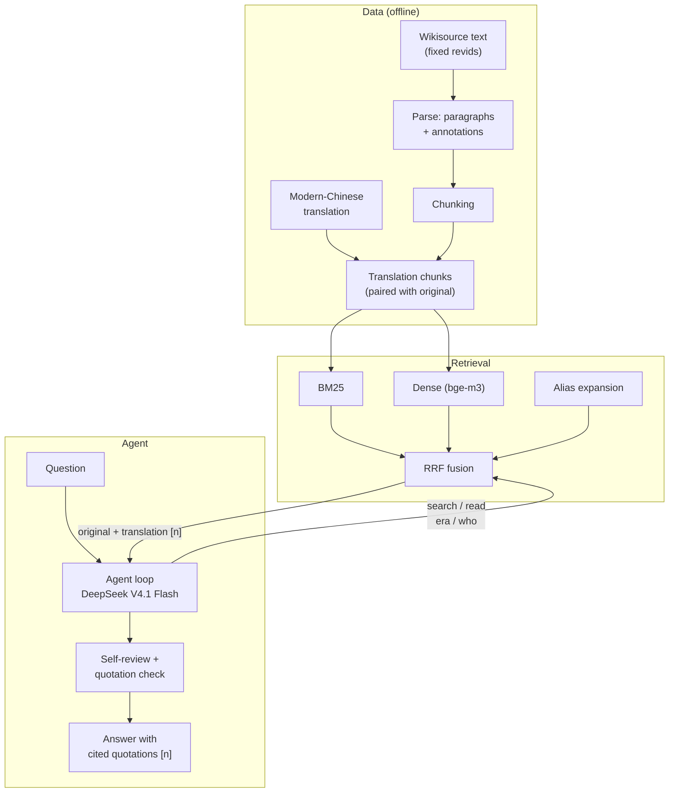

# sanguozhi-rag — Evidence-grounded Three Kingdoms Q&A

English | [中文](README.zh-CN.md)

[](https://github.com/DynHelium/sanguozhi-rag/actions/workflows/tests.yml)

A RAG project that answers questions about Three Kingdoms history from Chen Shou's *Records of the Three Kingdoms*
(*Sanguozhi*, 三国志) together with Pei Songzhi's annotations (裴松之注). A tool-using agent searches the original text
itself before answering. The model is asked to support facts with quotations from the original text, cited as `[n]`,
and code checks every quotation it finds in the answer character by character.

The whole pipeline lives in this repository: data preparation (parsing the original text, chunking, a full modern-Chinese
translation of the book), hybrid retrieval, the tool-calling agent, evaluation, a web chat UI, and history-based
games: "Three Kingdoms Turtle Soup" (三国海龟汤) and "Guess the Person" (猜人物).

The model is fixed: **DeepSeek V4.1 Flash** via OpenRouter, reasoning effort low. Retrieval runs over the modern-Chinese
translation, while the prompt asks the model to quote only the original Classical Chinese text, and code checks the
quotations it finds against it.

## What's included

Main parts:

- **Data and retrieval**
  - Download and parsing of the original text: Wikisource wikitext → paragraphs + Pei Songzhi's annotations (`ingest/`)
  - Chunking (`rag/chunk.py`): main text and annotations become separate chunks; each annotation chunk points back to the
    main-text passage it annotates
  - Retrieval: BM25 (character bigrams, `rag/bm25.py`), dense vectors (bge-m3, `rag/dense.py`), RRF fusion
    (`rag/fusion.py`), and query-side alias expansion (`rag/alias.py` + `data/aliases.json`, so a question about 曹操
    (Cao Cao) also finds passages that call him 魏太祖 or 曹公)
  - Retrieval evaluation: 49 questions (48 with gold passages scored by hit@k / MRR, plus 1 with no answer in the text;
    `eval/run_retrieval.py`)
- **Full modern-Chinese translation** (`data/processed/translations/`, 65 volumes): translated and proofread paragraph by
  paragraph by an LLM against the original text only, without consulting any modern translation. Retrieval searches the
  translation (`ingest/trans_chunks.py` pairs each original chunk with its translation); the model is still shown the
  original text plus the translation.
- **Data queries behind the tools** (`rag/library.py`): the agent's four tools, `search` (retrieval), `read` (surrounding
  context; an annotation comes with the main text it annotates), `era` (converts a reign-era year to the Common Era year)
  and `who` (whom a name or title refers to, and how many people share it), plus the `[n]` source numbers shown to the model.
- **LLM access** (`rag/llm.py`): an OpenAI-compatible interface that returns the full response (tool calls are read from
  `tool_calls`).
  - Wrapper for calls through OpenRouter (`rag/openrouter.py`): uses only the providers listed in `LLM_PROVIDERS` in
    `.env`, retries with backoff when rate-limited, and records tokens and cost.
- **Agent loop** (`rag/loop.py`): call the model → run the tools it asks for → send the results back as `tool` messages →
  call the model again, until it answers. The round limit is enforced in code (the last request carries no tools). The
  appendix `eval/tool_calling.py` is an early single-tool experiment on whether small local models use the tools
  interface reliably.
- **Full agent** (`rag/agent.py`): the model decides what to search and read; the code does no retrieval up front. The
  system prompt asks for three kinds of content, written separately: facts taken from retrieved original text (quoted,
  with a `[n]` number); inferences marked "据此推断" ("inferred from this") together with their basis; plot points from
  the novel *Romance of the Three Kingdoms* (三国演义) and modern equivalents of place names in a final paragraph labeled
  as not being records of the *Sanguozhi*. The code handles the round limit, a nudge to search more when too little was
  retrieved, a self-review after answering, verbatim quotation checks, and citation-number checks. Quotations that fail
  the check are flagged, but the code cannot guarantee that every fact in an answer has a source.
- **Agent evaluation** (`eval/run_agent.py`): 40 held-out questions (`eval/questions-holdout.jsonl`),
  a new set of 30 questions on inference / the novel / official titles and geography (`eval/questions-reason.jsonl`,
  with reference answers), 24 questions on fact-level errors (`eval/questions-facts.jsonl`) and 9 questions on people
  (`eval/questions-persons.jsonl`). Runs record which original passages the model saw and the time per question.
- **Web chat** (`app/chat.py`, Gradio): multi-turn conversation that shows the retrieval steps live while answering, and
  lists the cited original text, its translation and the quotation-check results below each answer.
- **Three Kingdoms Turtle Soup** (`rag/soup.py`, `app/soup.py`): a reasoning game with puzzles taken from the original
  text; see below.
- **Games in the chat** (`rag/skills.py`, `skills/*/SKILL.md`): saying "猜人物" or "海龟汤" in the web chat (or clicking
  a button) starts a game; while it runs, messages go to the game instead of the Q&A agent. Guess the Person
  (`rag/guess.py`) is described below.

Design and rationale: [docs/DESIGN.md](docs/DESIGN.md) (in Chinese). Deploying the web demo: [docs/DEPLOY.md](docs/DEPLOY.md) (in Chinese).

## Demo

![Web chat, three turns in English: which emperor was stabbed to death in the street, who stabbed him, and why the emperor attacked Sima Zhao himself; the retrieval steps appear live and the answers quote the original text with [n] citations (UI labels are in Chinese)](docs/images/chat-en.gif)

Another example, from the command line:

```bash
uv run python -m rag.agent "桃园结义是真的吗？刘关张在正史里是什么关系？" --openrouter --model deepseek-v4.1-flash --effort low
```

The question asks: "Is the Oath of the Peach Garden real? What was the relationship between Liu Bei, Guan Yu and Zhang Fei
in the official history?"

The trace below shows the model searching on its own first (its tool calls, marked `[model]`): three `search` calls with
different queries and one `read` to pull the context around an annotation chunk. `[code] review({}) -> []` is the
self-review step that the code triggers after the draft (one more model request). The answer then states the conclusion, quotes the original text with
`[n]` source numbers, gives an inference marked "据此推断" ("inferred from this"), and ends with a paragraph labeled as not
being a *Sanguozhi* record (the Peach Garden oath comes from the novel). The lines at the bottom are the code's check of
each quotation (✓ = found verbatim in the original text, with the chunk id it was found in):

```
[model] search({"query": "刘备 关羽 张飞 关系 情同兄弟"}) -> ['36-0000', '36-0006', ...]
[model] search({"query": "关羽 张飞 跟随刘备 侍立 终日"}) -> ['36-0000', '36-0006', ...]
[model] read({"chunk_id": "36-0000n0"}) -> ['36-0000', '36-0000n0', '36-0000n1']
[model] search({"query": "刘备 关羽 张飞 结拜 兄弟 桃园"}) -> ['36-0000', '36-0006', ...]
[code] review({}) -> []

结论：所谓"桃园结义"在《三国志》里没有找到相关记载，这是《三国演义》的说法。但正史里刘关张三人确实"恩若兄弟"……

「先主與二人寢則同床，恩若兄弟。」[1]
「張飛字益德，涿郡人也，少與關羽俱事先主。羽年長數歲，飛兄事之。」[2]
「吾極知曹公待我厚，然吾受劉將軍厚恩，誓以共死，不可背之。」[9]
……
据此推断：……正史中的三人关系亲密到"恩若兄弟"、患难与共、生死相托的程度，实质上是兄弟兼君臣的关系。……

以下不是《三国志》的记载：桃园结义是《三国演义》的说法。
  ✓ 36-0000  「先主與二人寢則同床，恩若兄弟。」
  ✓ 36-0006  「張飛字益德，涿郡人也，少與關羽俱事先主。羽年長數歲，飛兄事之。」
  ...
```

(Excerpt; the model's searches and wording differ from run to run.)

Quotations always stay in Classical Chinese, because that is what the code verifies. For orientation only, an English
gloss of the first quotation (a gloss, not a verified quotation): "The Former Lord [Liu Bei] slept in the same bed as the
two of them, and treated them with the kindness of brothers."

## Quickstart

Requires [uv](https://docs.astral.sh/uv/) and Python ≥ 3.11. Downloading the text and the embedding model needs network
access, and asking questions calls the model through OpenRouter, which is billed to your key. Start with a route that
needs no large downloads:

```bash
git clone https://github.com/DynHelium/sanguozhi-rag.git && cd sanguozhi-rag
uv sync                                          # base dependencies
uv run python -m ingest.use_wikisource           # download the punctuated Wikisource text at fixed revids, parse, chunk
uv run python -m rag.retrieve "关羽刮骨疗毒" --bm25   # run one query: print the source and text of the top 5 chunks
uv run python -m eval.run_retrieval -r bm25      # BM25 retrieval evaluation
```

Output of `rag.retrieve` (per chunk: rank, volume and section title, main text or annotation, chunk id, original text;
only the start of the first chunk is shown):

```
[1] 蜀書六 關張馬黃趙傳·關羽 正文 (36-0003)
    羽嘗為流矢所中，貫其左臂，後創雖愈，每至陰雨，骨常疼痛，醫曰：「矢鏃有毒，毒入於骨，當破臂作創，刮骨去毒……
```

Next, add dense retrieval (downloads bge-m3, about 2.3 GB):

```bash
uv sync --extra index
uv run python -m rag.dense                       # encode the whole book, cached in data/index/ (about 5 minutes on Apple Silicon)
uv run python -m rag.retrieve "曹操因为什么逃离洛阳？"            # BM25 + dense + alias expansion
uv run python -m eval.run_retrieval -r hybrid --alias route2           # add --strict for the strict metric

uv run python -m ingest.trans_chunks             # translation retrieval chunks (each original chunk paired with its translation)
uv run python -m rag.dense --trans               # encode the translation chunks (about 7 minutes)
uv run python -m eval.run_retrieval -r hybrid --index trans --alias route2   # search the translation
```

Connecting the LLM: `cp .env.example .env`, put your OpenRouter key in `LLM_API_KEY`, then run `uv run python -m rag.llm`
to send one message and check the connection. Web chat (needs the translation index above and `.env`):

```bash
uv sync --extra index --extra ui
uv run python -m app.chat --openrouter --model deepseek-v4.1-flash --effort low   # open http://localhost:7860
```

Tests make no LLM calls and need no network: `uv run python -m tests` runs them all (the one case in `test_dense` that uses
the real bge-m3 model needs `uv sync --extra index` and the bge-m3 model already on disk, which one run of `rag.dense`
takes care of, or `ALLOW_MODEL_DOWNLOAD=1` to let the test download it; otherwise it is skipped). GitHub Actions runs
the same tests on Linux / macOS / Windows.

## How it works



Search in modern Chinese, quote in the original: the translation helps the model find passages and understand the
Classical Chinese. The prompt asks the model to quote only the original text; code checks the quotations it extracts
from the answer verbatim and flags those that fail, but it does not guarantee that every fact has a source.

## Evaluation

### Retrieval

48 retrieval questions with gold passages (the 49th has no answer in the text), searched over the original text.
hit@k: whether a chunk containing the answer passage is among the top k. Two metrics: **loose** also counts an annotation attached to the answer passage as a hit; **strict** counts
only the answer passage itself.

| Retriever | hit@1 | hit@5 | hit@10 | MRR |
|---|---|---|---|---|
| BM25 | 0.25 / 0.23 | 0.31 / 0.29 | 0.40 / 0.35 | 0.28 / 0.26 |
| BM25 + dense (RRF) | 0.31 / 0.27 | 0.54 / 0.50 | 0.65 / 0.60 | 0.42 / 0.38 |
| + alias expansion | 0.31 / 0.27 | 0.60 / 0.56 | 0.69 / 0.65 | 0.43 / 0.39 |
| Search the translation: BM25 | 0.40 / 0.40 | 0.60 / 0.56 | 0.62 / 0.58 | 0.49 / 0.46 |
| Search the translation: BM25 + dense + alias expansion (used by the agent) | 0.52 / 0.48 | 0.67 / 0.62 | 0.81 / 0.75 | 0.59 / 0.54 |

(Loose / strict.) The main difficulty is matching modern-Chinese questions against Classical Chinese text: for the query
"曹操因为什么逃离洛阳" ("Why did Cao Cao flee Luoyang?") above, the original text calls him "太祖", so BM25 cannot find
it. The translation is in modern Chinese, and its wording and date formats are close to how questions are asked
("薨" → "去世" (died), "七年" → "建安七年" (7th year of Jian'an)), so searching the translation works much better; titles
for the same person (太祖, 曹公, 魏武) are handled by alias expansion. The query stop-word list was chosen with these 48
questions in view, so they count as a development set.

### Answer quality

DeepSeek V4.1 Flash (reasoning effort low), one run per question set. Each answer was judged by an AI model following
written judging rules, against the original text; for some questions (official titles and geography) against reference
answers, and extra background the question did not ask for is not scored. The rules are in
[`eval/judge_prompt.md`](https://github.com/DynHelium/sanguozhi-rag/blob/eval-judging/eval/judge_prompt.md) on the
[`eval-judging`](https://github.com/DynHelium/sanguozhi-rag/tree/eval-judging) branch, together with the per-question
answers and judgments.

| Question set | Correct / total | Time per question |
|---|---|---|
| Held-out (`eval/questions-holdout.jsonl`) | 40 / 40 | about 41 s |
| Inference / the novel / official titles and geography (`eval/questions-reason.jsonl`) | 25 / 30 (1 partial, 4 wrong) | about 52 s |
| Fact-level errors: numbers, reign eras, people with the same name, variant accounts in the annotations (`eval/questions-facts.jsonl`) | 22 / 24 (2 partial) | about 36 s |
| People, from well-known to obscure: from Liu Bei and Cao Cao to Himiko (卑弥呼) and Empress Wu (吴皇后) (`eval/questions-persons.jsonl`) | 9 / 9 | about 48 s |

Of the 4 wrong answers in the inference set, 2 add a detail the original text does not contain (a year, and a "night
raid"), and 2 misread the order or the target of a passage (the timing of Tian Feng's advice, and what Sun Sheng's comment
is about); a confidently stated fact that cannot be found in the source, or that contradicts
it, counts as wrong. The 2 partial answers in the fact set each miss one item (one person sharing a name; one of Pei
Songzhi's corrections). The question sets are small and results vary between runs; treat them as indicative only.

```bash
uv run python -m eval.run_agent --openrouter --models deepseek-v4.1-flash --effort low \
    --questions eval/questions-holdout.jsonl --name ho1        # run the questions; results in data/processed/eval_runs/answers/ho1.jsonl
uv run python -m eval.run_agent --summary --name ho1           # summary: share of gold passages seen / fully found
```

## Three Kingdoms Turtle Soup

"Turtle soup" (海龟汤) is the Chinese name for a lateral-thinking puzzle game: the player is given a strange scenario
(the "soup surface", 汤面), may ask only questions that can be answered yes or no, and finally has to state the full
story behind it (the "soup base", 汤底). Here every puzzle is taken from the *Sanguozhi*, and each soup base is tied to its
source passage. The puzzle bank `data/soup/puzzles.jsonl` has three tiers: well-known people (Liu Bei, Zhuge Liang,
Cao Cao, Guan Yu), lesser-known people (Zhang Song, Cao Chong, Zhuge Liang's wife), and the most obscure (Himiko,
Empress Wu, Cao Jie).

```bash
uv sync --extra ui
uv run python -m app.soup --openrouter --model deepseek-v4.1-flash --effort low   # open http://localhost:7861
```

- The judge (`rag/soup.py`) is given only this puzzle's soup base and the original-text evidence. Its prompt asks it to
  decide from those alone and give only the conclusion: yes / no for yes-no questions, the chosen option for
  either-or questions, "irrelevant" for details that do not matter, "not recorded" for things the text does not say
  (no forced true-or-false verdict), and for ambiguous questions an answer under its own reading, with a few words on
  which reading it used. It gives no information beyond what was asked. Code does not pre-filter questions; its only check is against leaks: if the answer contains the name of
  the person behind the puzzle, it is replaced with a "can't say that" reply.
- When the player submits a solution, it is judged point by point against the required key points; it counts as solved
  only if all of them are covered with no contradiction. If not, the game says how many points were covered, not which
  ones are missing.
- `uv run python -m eval.soup --openrouter` tests the judge's accuracy against each puzzle's reference questions and answers.
- It can also be played in the web chat (`app/chat.py`): say "海龟汤" or click the button to start, and submit a
  solution with "/答 your explanation".


## Guess the Person

Say "猜人物" in the web chat or click the button to start (command line: `uv run python -m rag.skills --openrouter`).
There are two modes:

- **You guess**: the program picks a person from the *Sanguozhi* at random; you may ask up to 20 yes-no or either-or
  questions, then name the person. The pick is made by code: it draws a random passage from the main text, finds the
  people from the alias table who appear in it, and picks one weighted by 1 / the number of passages that person appears
  in across the book (without the weighting Cao Cao would come up far too often).
- **The agent guesses**: you think of a person; the agent asks yes-no questions (up to 25), can use the retrieval tools
  to look things up in the original text, and finally guesses a name.

The answer stays in code: the chat model does not know it. The judge is a separate conversation that gets the original
passages about the person up front, judges each question on its own, and gives only the conclusion (yes / no, an
option, or "not recorded"); if its answer contains the person's name or any of their other names, code blocks it.
When you guess a name, code compares it with the person's name and the names in the alias table, and the reveal shows
where the person appears in the *Sanguozhi*.

The conversation is stored in the browser, so after a page refresh the conversation and any game in progress are still
there (a game is lost if the server restarts). "清除对话" (clear conversation) clears both the chat history and the game.

## Quotation checks

`rag/quotes.py` runs two purely code-based checks: whether text quoted in 「」 in an answer can be found verbatim in the
original-text chunks the model has seen (differences between traditional and simplified characters and in punctuation
are allowed), and whether the `[n]` number right after a quotation points to a chunk that contains it. The code corrects the number
only when the quotation carries a single number and exactly one of the chunks the model has seen contains the text; in
every other case it only reports the result. Quotations that cannot be found are marked as failing verification;
the cause may be a misremembered character or a variant character. These checks cover only the quotations themselves and
cannot guarantee that paraphrases or interpretations of the history are correct.

## Limitations

- Answers rely only on the *Sanguozhi* and Pei Songzhi's annotations. For questions outside that scope (other histories,
  later assessments) the prompt asks the model to say nothing was found; this is not enforced by code.
- The modern-Chinese translation was produced by an LLM and proofread only against the original text, so it will contain
  errors; it is used only for retrieval and to aid understanding, and quotations in answers always use the original text.
- The quotation check only proves that "this text is in the original and the citation number is right"; it cannot
  guarantee that paraphrases and interpretations are correct.
- The evaluation question sets are small, and each was run only once.

## Data and licenses

- The punctuated original text of the whole book is **not distributed** with this repository; the full text included
  here is unpunctuated (`data/sources/sanguozhi/baiwen.jsonl`, punctuation removed). The *Sanguozhi* main text and Pei
  Songzhi's annotations are in the public domain, but the sentence breaks and punctuation in the Wikisource transcription
  follow the Zhonghua Book Company (中华书局) critical edition. `ingest.use_wikisource` downloads the punctuated text from
  Wikisource at fixed revids, so the result is reproducible.
- Short excerpts of the original text in the puzzle bank (`data/soup/`) keep the Wikisource punctuation; they are there to
  cite the source of each puzzle.
- Code: MIT ([LICENSE](LICENSE)). Data (the files under `data/`, the question sets `eval/*.jsonl`, the puzzle bank, and
  the evaluation results on the `eval-judging` branch): CC BY-SA 4.0; see [LICENSE-DATA](LICENSE-DATA) (in Chinese) for
  the exact list and sources.

## Credits

The author hand-wrote the LLM access (`rag/llm.py`), the agent loop (`rag/loop.py`) and the retrieval algorithms
(tokenization, BM25, dense retrieval, fusion, query expansion). Claude (Anthropic's AI assistant) wrote the prompts, data
preparation scripts, data queries behind the tools, agent wiring, evaluation framework, web pages, the Turtle Soup game,
Guess the Person and the skill routing, tests and documentation.
