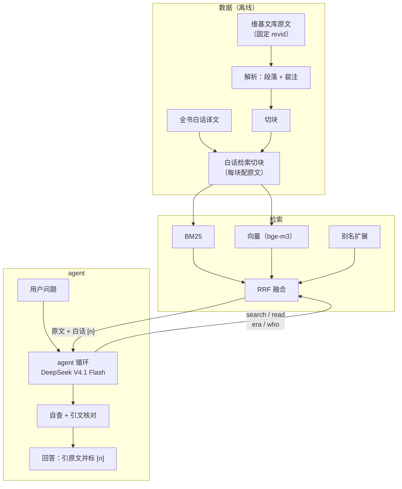

# sanguozhi-rag

[English](README.md) | 中文

[](https://github.com/DynHelium/sanguozhi-rag/actions/workflows/tests.yml)

依据《三国志》（陈寿正文 + 裴松之注）回答三国历史问题的 RAG 项目：模型自己检索原文再作答，prompt 要求事实引原文、标出处，
回答里抽到的引文由代码逐字核对。从数据准备（原文解析、切块、全书白话译文）、混合检索，到会调用工具的 agent、评测、网页聊天和
基于史料的游戏（三国海龟汤、猜人物），整条链路都在这个仓库里。
大模型固定用 **DeepSeek V4.1 Flash**（经 OpenRouter，思考 low）。

## 现在有什么

主要部分：

- **数据与检索**
  - 原文下载与解析：维基文库 wikitext → 段落 + 裴注（`ingest/`）
  - 切块（`rag/chunk.py`）：正文、裴注各自成块，裴注指回所注正文
  - 检索：BM25（字 bigram，`rag/bm25.py`）、向量（bge-m3，`rag/dense.py`）、RRF 融合（`rag/fusion.py`）、
    查询侧别名扩展（`rag/alias.py` + `data/aliases.json`，问"曹操"也能找到写"魏太祖""曹公"的段落）
  - 检索评测：49 道题（48 道标了 gold 段落，算 hit@k / MRR；另 1 道原文里没有答案），`eval/run_retrieval.py`
- **全书白话译文**（`data/processed/translations/`，65 卷）：大模型对照原文逐段翻译、校对，只对照原文、不参考现代译本。
  检索时搜白话（`ingest/trans_chunks.py` 给每块原文配上译文），给模型看的仍是原文加译文
- **工具背后的数据查询**（`rag/library.py`）：agent 的四个工具 search（检索）、read（读前后文，裴注附上所注正文）、
  era（年号换算公元年）、who（一个称呼指谁、有几个同名的人），以及给模型看的资料编号 `[n]`
- **接入大模型**（`rag/llm.py`）：OpenAI 兼容接口，返回完整响应（工具调用要看 `tool_calls`）
  - 经 OpenRouter 调用时的包装（`rag/openrouter.py`）：只用 `.env` 里 `LLM_PROVIDERS` 指定的服务商，限流时退避重试，记录 token 和花费
- **agent 循环**（`rag/loop.py`）：调模型 → 执行模型要的工具 → 结果作为 `tool` 消息发回 → 再调模型，直到它作答；
  轮数上限由代码保证（最后一次请求不带工具）。附录 `eval/tool_calling.py` 是早期的单工具实验：
  本地小模型能不能稳定地用 tools 接口。

- **完整的 agent**（`rag/agent.py`）：模型自己决定搜什么、读什么，代码不预先检索。system prompt 要求回答分三类写：事实取自查到的原文
  （引原文、标编号 `[n]`），推断写明"据此推断"和依据，《三国演义》情节和地名今释放在最后一段并标明"不是《三国志》的记载"。
  代码负责轮数上限、查得太少时提示再查、作答后自查、引文逐字核对和出处编号核对；核对不过的引文会标出，但代码不保证每个事实都有出处

- **agent 评测**（`eval/run_agent.py`）：留出题 40 道（`eval/questions-holdout.jsonl`）和
  推断 / 演义 / 官职地理新题集 30 道（`eval/questions-reason.jsonl`，带参考答案）、事实级错误 24 道（`eval/questions-facts.jsonl`）、
  人物 9 道（`eval/questions-persons.jsonl`）；记录模型看到了哪些原文和每题用时
- **网页聊天**（`app/chat.py`，Gradio）：多轮对话，回答时实时显示检索过程，回答下面列出引用到的原文、白话和引文核对结果。

- **三国海龟汤**（`rag/soup.py`、`app/soup.py`）：题目取自原文的推理游戏，见下文
- **聊天里的游戏**（`rag/skills.py`、`skills/*/SKILL.md`）：在网页聊天里说"猜人物"或"海龟汤"（或点按钮）就开一局，
  游戏中的消息交给游戏，不走问答 agent。猜人物（`rag/guess.py`）见下文

设计和理由见 [docs/DESIGN.md](docs/DESIGN.md)，部署网页 demo 见 [docs/DEPLOY.md](docs/DEPLOY.md)。

## 架构



检索时搜白话，回答时只引原文：白话译文帮模型找到段落、读懂文言。prompt 要求引文只取原文；代码逐字核对从回答里抽到的引文，
核对不过的会标出，但不保证每个事实都有出处。

## 快速开始

需要 [uv](https://docs.astral.sh/uv/) 和 Python ≥ 3.11。下载原文和向量模型要联网，问答经 OpenRouter 调用模型，
按你的 key 计费。先走一条不用下载大文件的路线：

```bash
git clone https://github.com/DynHelium/sanguozhi-rag.git && cd sanguozhi-rag
uv sync                                          # 基础依赖
uv run python -m ingest.use_wikisource           # 按固定 revid 下载维基文库标点版, 解析, 切块
uv run python -m rag.retrieve "关羽刮骨疗毒" --bm25   # 查一个问题: 打印前 5 块的出处和原文
uv run python -m eval.run_retrieval -r bm25      # BM25 检索评测
```

`rag.retrieve` 的输出（每块：编号、卷名和小标题、正文还是裴注、chunk id、原文；这里只摘了第一块的开头）：

```
[1] 蜀書六 關張馬黃趙傳·關羽 正文 (36-0003)
    羽嘗為流矢所中，貫其左臂，後創雖愈，每至陰雨，骨常疼痛，醫曰：「矢鏃有毒，毒入於骨，當破臂作創，刮骨去毒……
```

下一步加上向量检索（会下载 bge-m3，约 2.3GB）：

```bash
uv sync --extra index
uv run python -m rag.dense                       # 编码全书, 缓存到 data/index/ (Apple Silicon 上约 5 分钟)
uv run python -m rag.retrieve "曹操因为什么逃离洛阳？"            # BM25 + 向量 + 别名扩展
uv run python -m eval.run_retrieval -r hybrid --alias route2           # 加 --strict 看严格口径

uv run python -m ingest.trans_chunks             # 白话检索切块 (每块原文配上译文)
uv run python -m rag.dense --trans               # 编码白话切块 (约 7 分钟)
uv run python -m eval.run_retrieval -r hybrid --index trans --alias route2   # 搜白话
```

接大模型：`cp .env.example .env`，在 `LLM_API_KEY` 填 OpenRouter 的 key，`uv run python -m rag.llm` 发一句话测连通。
网页聊天（需要上面的白话索引和 `.env`）：

```bash
uv sync --extra index --extra ui
uv run python -m app.chat --openrouter --model deepseek-v4.1-flash --effort low   # 打开 http://localhost:7860
```

测试不调大模型，不连网：`uv run python -m tests` 跑全部（`test_dense` 里用真实 bge-m3 的一项要先 `uv sync --extra index`，
并且本地已有 bge-m3 模型（跑过一次 `rag.dense` 即可），或设 `ALLOW_MODEL_DOWNLOAD=1` 让测试去下载，否则跳过）。GitHub Actions 在 Linux / macOS / Windows 上跑同一套测试。

## 一个例子

![网页聊天，三轮追问：哪个皇帝在街上被刺死、刺死他的是谁、皇帝为什么亲自讨伐司马昭；实时显示检索过程，回答引原文并标编号 [n]](docs/images/chat-zh.gif)

另一个例子，用命令行问：

```bash
uv run python -m rag.agent "桃园结义是真的吗？刘关张在正史里是什么关系？" --openrouter --model deepseek-v4.1-flash --effort low
```

模型先自己检索（下面是它的工具调用），再作答；最后一行起是代码对每条引文的核对（✓ = 原文里逐字找得到）：

```
[model] search({"query": "刘备 关羽 张飞 关系 情同兄弟"}) -> ['36-0000', '36-0006', ...]
[model] search({"query": "关羽 张飞 跟随刘备 侍立 终日"}) -> ['36-0000', '36-0006', ...]
[model] read({"chunk_id": "36-0000n0"}) -> ['36-0000', '36-0000n0', '36-0000n1']
[model] search({"query": "刘备 关羽 张飞 结拜 兄弟 桃园"}) -> ['36-0000', '36-0006', ...]
[code] review({}) -> []

结论：所谓"桃园结义"在《三国志》里没有找到相关记载，这是《三国演义》的说法。但正史里刘关张三人确实"恩若兄弟"……

「先主與二人寢則同床，恩若兄弟。」[1]
「張飛字益德，涿郡人也，少與關羽俱事先主。羽年長數歲，飛兄事之。」[2]
「吾極知曹公待我厚，然吾受劉將軍厚恩，誓以共死，不可背之。」[9]
……
据此推断：……正史中的三人关系亲密到"恩若兄弟"、患难与共、生死相托的程度，实质上是兄弟兼君臣的关系。……

以下不是《三国志》的记载：桃园结义是《三国演义》的说法。
  ✓ 36-0000  「先主與二人寢則同床，恩若兄弟。」
  ✓ 36-0006  「張飛字益德，涿郡人也，少與關羽俱事先主。羽年長數歲，飛兄事之。」
  ...
```

（节选；模型每次的检索和措辞会有不同。）

## 检索效果

48 道标了 gold 段落的检索题（第 49 道原文里没有答案），在原文上检索。hit@k：前 k 块里有没有包含答案段落的块。两种口径：**宽松**把"答案段落上挂的裴注"
也算找到，**严格**只认答案段落本身。

| 检索 | hit@1 | hit@5 | hit@10 | MRR |
|---|---|---|---|---|
| BM25 | 0.25 / 0.23 | 0.31 / 0.29 | 0.40 / 0.35 | 0.28 / 0.26 |
| BM25 + 向量（RRF） | 0.31 / 0.27 | 0.54 / 0.50 | 0.65 / 0.60 | 0.42 / 0.38 |
| 再加别名扩展 | 0.31 / 0.27 | 0.60 / 0.56 | 0.69 / 0.65 | 0.43 / 0.39 |
| 改搜白话译文：BM25 | 0.40 / 0.40 | 0.60 / 0.56 | 0.62 / 0.58 | 0.49 / 0.46 |
| 改搜白话译文：BM25 + 向量 + 别名扩展（agent 用的） | 0.52 / 0.48 | 0.67 / 0.62 | 0.81 / 0.75 | 0.59 / 0.54 |

（宽松 / 严格）白话提问对文言原文是原文检索的主要难点：上面"曹操因为什么逃离洛阳"一句，原文写的是"太祖"，
BM25 找不到。译文是现代汉语，用词和年份写法贴近白话提问（"薨" → "去世"，"七年" → "建安七年"），所以搜白话好得多；
称谓（太祖、曹公、魏武）由别名扩展处理。这 48 题的问句停用词是照着它们挑的，算开发集。

## 回答效果

DeepSeek V4.1 Flash（思考 low），每套题跑一遍。每个回答由 AI 按成文的判卷规则逐题评定：对照原文，部分题（官职地理）对照参考答案，
题目没要求的额外背景不计分。判卷规则见 `eval-judging` 分支的
[`eval/judge_prompt.md`](https://github.com/DynHelium/sanguozhi-rag/blob/eval-judging/eval/judge_prompt.md)，逐题的回答和判卷结果也在
[`eval-judging`](https://github.com/DynHelium/sanguozhi-rag/tree/eval-judging) 分支。

| 题集 | 对 / 题数 | 每题用时 |
|---|---|---|
| 留出题（`eval/questions-holdout.jsonl`） | 40 / 40 | 约 41 秒 |
| 推断 / 演义 / 官职地理（`eval/questions-reason.jsonl`） | 25 / 30（部分对 1，错 4） | 约 52 秒 |
| 事实级错误：数字、年号、同名人物、裴注异说（`eval/questions-facts.jsonl`） | 22 / 24（部分对 2） | 约 36 秒 |
| 人物（从常见到冷门）：从刘备、曹操到卑弥呼、吴皇后（`eval/questions-persons.jsonl`） | 9 / 9 | 约 48 秒 |

推断题错的 4 题：2 题添了原文没有的细节（一个年份、一处"夜袭"），2 题误读了原文的先后或所指（田丰进言的时序、孙盛按语针对的事）；
和原文矛盾、或原文查不到却说得很确定的具体事实都算错。
事实题的 2 题部分对，都是漏了一项（少列一个同名人物、漏了裴松之的考订）。题量小，一遍的结果有波动，只作参考。

```bash
uv run python -m eval.run_agent --openrouter --models deepseek-v4.1-flash --effort low \
    --questions eval/questions-holdout.jsonl --name ho1        # 跑题, 结果在 data/processed/eval_runs/answers/ho1.jsonl
uv run python -m eval.run_agent --summary --name ho1           # 汇总: 看到 / 找全 gold 段落的比例
```

## 三国海龟汤

海龟汤是情境推理游戏：给一个离奇的"汤面"，玩家只能问能用 是 / 不是 回答的问题，最后说出完整的"汤底"。
这里的题目都取自《三国志》原文，每道题的汤底绑定原文出处。题库 `data/soup/puzzles.jsonl` 分三档：
常见人物（刘备、诸葛亮、曹操、关羽）、冷门人物（张松、曹冲、诸葛亮之妻）、最冷门（卑弥呼、吴皇后、曹节）。

```bash
uv sync --extra ui
uv run python -m app.soup --openrouter --model deepseek-v4.1-flash --effort low   # 打开 http://localhost:7861
```

- 裁判（`rag/soup.py`）只拿到这道题的汤底和原文证据，prompt 要求只据此判断、只答结论：是非题答 是 / 不是，二选一答选项，
  无关紧要的细节答"无关"，原文没写的答"没有记载"（不硬判真假），问法有歧义时按自己的理解答、只用几个字说明按哪种意思；
  不提供问题以外的信息。代码不预先拦问题，
  唯一的代码检查是防泄底：回答里出现谜底人名就换成一句"不能说"。
- 提交汤底时按"必需要点"逐条判，全说到且没有矛盾才算猜中；没猜中时只说说到了几条，不说缺哪条。
- `uv run python -m eval.soup --openrouter` 用每题的标准问答测裁判判得准不准。
- 也可以在网页聊天（`app/chat.py`）里玩：说"海龟汤"或点按钮开局，"/答 你的解释"提交汤底。


## 猜人物

在网页聊天里说"猜人物"或点按钮开局（命令行：`uv run python -m rag.skills --openrouter`），有两种玩法：

- **你来猜**：程序随机定一个《三国志》人物，你最多问 20 个是非题或二选一的问题，再说出名字。出题由代码随机：
  从全书正文里随机抽一段，找出其中出现的别名表人物，按 1 / 这个人在全书出现的段数加权挑一个（不加权的话曹操会占很大比例）。
- **我来猜**：你心里想一个人，Agent 问是非问题（最多 25 次），可以用检索工具查原文，最后猜名字。

谜底只在代码里：聊天里的模型不知道谜底，裁判是另开的一段对话，预先拿到谜底的出处原文，每个问题单独判，只答结论
（是 / 不是、选项、没有记载）；回答里出现谜底的名字或称呼就由代码拦下。你猜名字时由代码比对人名和别名表里的称呼，
揭晓时给出这个人在《三国志》里的出处。

对话历史存在浏览器里，刷新页面后对话和正在玩的游戏都还在（服务重启后游戏会丢）；"清除对话"清掉聊天记录和游戏。

## 引文核对

`rag/quotes.py` 做两项纯代码检查：回答里「」引用的文字能不能在模型看过的原文块里逐字找到（允许繁简和标点不同）；
紧跟在引文后面的编号 `[n]` 指的那一块里有没有这段文字。只有引文只标了一个编号、且模型看过的资料里恰好只有一块包含这段文字时，
代码才自动改正编号；其他情况只报告核对结果。
找不到的引文标为"未通过核验"，可能是记错字，也可能是异体字。这两项只核对引文本身，不能保证转述和对史实的解释正确。

## 原文与授权

- 全书带标点的原文**不随仓库发布**，仓库里的全书原文是白文（`data/sources/sanguozhi/baiwen.jsonl`，去掉了标点）：
  《三国志》正文和裴注是公有领域，但维基文库录入的断句标点沿用中华书局点校本。`ingest.use_wikisource` 会按固定 revid
  从维基文库下载标点版，结果可复现。
- 题库（`data/soup/`）里的原文摘录保留了维基文库的标点：都是短摘录，用于标明每道题的出处。
- 代码：MIT（[LICENSE](LICENSE)）。数据（`data/` 下的数据文件、`eval/*.jsonl` 题集、海龟汤题库，以及 `eval-judging` 分支的评测结果）：
  CC BY-SA 4.0，具体范围和来源见 [LICENSE-DATA](LICENSE-DATA)。

## 局限

- 只依据《三国志》和裴注。问题超出这个范围（其他史书、后世评价）时，prompt 要求模型说没找到，代码不强制。
- 白话译文由大模型翻译、只对照原文校对，难免有错；它只用来检索和帮助理解，回答里的引文一律用原文。
- 引文核对只证明"这段文字原文里有、出处编号对"，不能保证转述和对史实的解释都对。
- 评测题量小，每套只跑一遍。

## 分工

作者手写接入大模型（`rag/llm.py`）、agent 循环（`rag/loop.py`）和检索算法（分词、BM25、向量、融合、查询扩展）。
Claude（Anthropic 的 AI 助手）编写 prompt、数据准备脚本、工具背后的数据查询、agent 接线、评测框架、网页、海龟汤、猜人物和 skill 路由、测试和文档。
