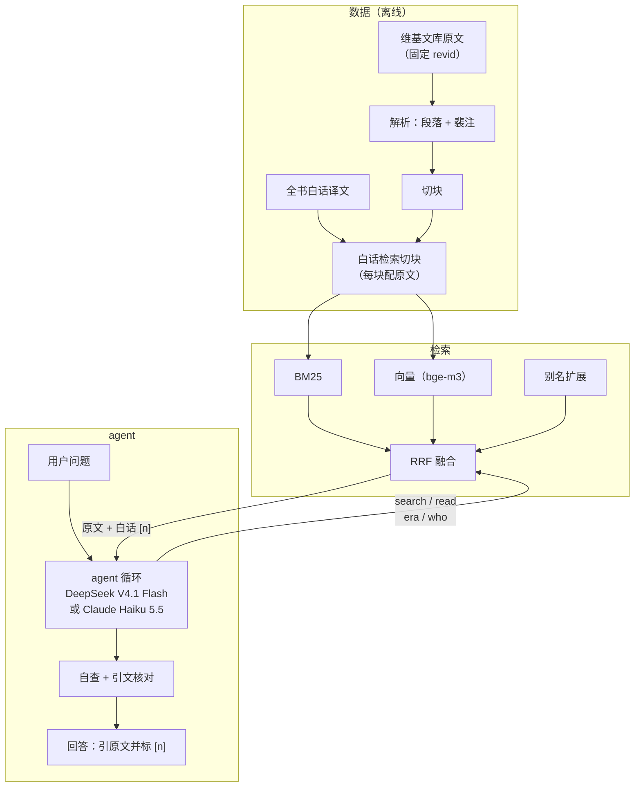

# sanguozhi-rag

[English](README.md) | 中文

[](https://github.com/DynHelium/sanguozhi-rag/actions/workflows/tests.yml)
[](https://huggingface.co/spaces/helium-hf/sanguozhi-rag)

**在线试用**：[huggingface.co/spaces/helium-hf/sanguozhi-rag](https://huggingface.co/spaces/helium-hf/sanguozhi-rag)，
网页聊天，模型是 Claude Haiku 5.5（中文、英文提问都可以；两个游戏只有中文）。每天有花费上限，用完后当天不再回答（服务重启会重新计）；
一段时间没人访问会休眠，之后第一个打开的人要等两分钟左右重启。

**一句话**：在一部 3 世纪的文言史书上做 agentic RAG。提问是白话或英文，原文是文言，两边用词很少重合。检索改搜大模型翻译的白话译文
（document expansion），加上 BM25 + 向量混合检索和别名扩展，开发题 hit@10 从 0.40 提到 0.81（留出题 0.78 → 0.97）。同一模型、
同 103 道中文题对照：闭卷全对 61 题（37 个回答夹带原文查不到的内容），检索一次 79 题，agent 101 题；同样 103 道题用英文问，分别为 71 / 36 / 99。
回答里的每段引文都由代码对照原文核对。

依据《三国志》（陈寿正文 + 裴松之注）回答三国历史问题的 RAG 项目：模型自己检索原文再作答，prompt 要求事实引原文、标出处，
回答里抽到的引文由代码逐字核对。从数据准备（原文解析、切块、全书白话译文）、混合检索，到会调用工具的 agent、评测、网页聊天和
基于史料的游戏（三国海龟汤、猜人物），整条链路都在这个仓库里。
大模型支持两种后端：**DeepSeek V4.1 Flash**（经 OpenRouter，思考 low，默认）和 **Claude Haiku 5.5**（Claude 原生接口，`LLM_BACKEND=anthropic`，思考 medium）；对照见[两种后端](#两种后端)。

## 现在有什么

主要部分：

- **数据与检索**
  - 原文下载与解析：维基文库 wikitext → 段落 + 裴注（`ingest/`）
  - 切块（`rag/chunk.py`）：正文、裴注各自成块，裴注指回所注正文
  - 检索：BM25（字 bigram，`rag/bm25.py`）、向量（bge-m3，`rag/dense.py`）、RRF 融合（`rag/fusion.py`）、
    查询侧别名扩展（`rag/alias.py` + `data/aliases.json`，问"曹操"也能找到写"魏太祖""曹公"的段落）
  - 检索评测：49 道题（48 道标了 gold 段落，算 hit@k / MRR；另 1 道原文里没有答案），`eval/run_retrieval.py`
- **全书白话译文**（`data/processed/translations/`，65 卷）：大模型对照原文逐段翻译、校对，只对照原文、不参考现代译本。
  检索时搜白话（`ingest/trans_chunks.py` 给每块原文配上译文），给模型看的仍是原文加译文
- **工具背后的数据查询**（`rag/library.py`）：agent 的四个工具 search（检索）、read（读前后文，裴注附上所注正文）、
  era（年号换算公元年）、who（一个称呼指谁、有几个同名的人），以及给模型看的资料编号 `[n]`
- **接入大模型**（`rag/llm.py`）：OpenAI 兼容接口，返回完整响应（工具调用要看 `tool_calls`）。`LLM_BACKEND=anthropic` 时同一个调用转给 `rag/claude_llm.py`：经 Anthropic SDK（可选依赖 `anthropic`）调 Claude Messages API，返回同样形状的响应，所以 agent、游戏、网页聊天和评测脚本都不用改。它随工具调用回传模型的思考块，历史只追加不改写（提示缓存才生效），并传递思考强度
  - 各入口共用的请求包装（`rag/calls.py`）：启动时检查 `.env` 里这个后端的 key 填了没有、模型和后端对不对得上（`claude-*` 模型要 `LLM_BACKEND=anthropic`），限流时退避重试（Claude 原生接口报花费上限已到的 429 除外），记录 token 和花费；经 OpenRouter 时让它在响应里返回花费，并只用 `LLM_PROVIDERS` 指定的服务商。后端只在 `.env` 里选；本地模型（把 OpenAI 兼容接口指到 Ollama 等）暂时不支持
- **agent 循环**（`rag/loop.py`）：调模型 → 执行模型要的工具 → 结果作为 `tool` 消息发回 → 再调模型，直到它作答；
  轮数上限由代码保证（最后一次请求不带工具）。附录 `eval/tool_calling.py` 是早期的单工具实验：
  本地小模型能不能稳定地用 tools 接口（实测要本地模型，暂时跑不了；它的假模型测试照常能跑）。

- **完整的 agent**（`rag/agent.py`）：模型自己决定搜什么、读什么，代码不预先检索。system prompt 要求回答分三类写：事实取自查到的原文
  （引原文、标编号 `[n]`），推断写明"据此推断"和依据，《三国演义》情节和地名今释放在最后一段并标明"不是《三国志》的记载"。
  代码负责轮数上限、查得太少时提示再查、作答后自查、引文逐字核对和出处编号核对；核对不过的引文会标出，但代码不保证每个事实都有出处

- **agent 评测**（`eval/run_agent.py`）：留出题 40 道（`eval/questions-holdout.jsonl`）和
  推断 / 演义 / 官职地理新题集 30 道（`eval/questions-reason.jsonl`，带参考答案）、事实级错误 24 道（`eval/questions-facts.jsonl`）、
  人物 9 道（`eval/questions-persons.jsonl`）；记录模型看到了哪些原文和每题用时
- **网页聊天**（`app/chat.py`，Gradio）：多轮对话，回答时实时显示检索过程，回答下面列出引用到的原文、白话和引文核对结果。

- **三国海龟汤**（`rag/soup.py`、`app/soup.py`）：题目取自原文的推理游戏，见下文
- **聊天里的游戏**（`rag/skills.py`、`skills/*/SKILL.md`）：游戏是问答 agent 的 skill：agent 有 `start_game` / `end_game` 两个工具，
  你用自己的话说想玩，它就开局（按钮直接开局）。游戏中的消息先交给游戏，游戏判断不是游戏里的话再交回 agent。猜人物（`rag/guess.py`）见下文

设计和理由见 [docs/DESIGN.md](docs/DESIGN.md)，部署网页 demo 见 [docs/DEPLOY.md](docs/DEPLOY.md)。

## 架构



检索时搜白话，回答时只引原文：白话译文帮模型找到段落、读懂文言。prompt 要求引文只取原文；代码逐字核对从回答里抽到的引文，
核对不过的会标出，但不保证每个事实都有出处。

## 快速开始

需要 [uv](https://docs.astral.sh/uv/) 和 Python ≥ 3.11。下载原文和向量模型要联网，问答经 OpenRouter 或 Claude API 调用模型，
按你的 key 计费。先走一条不用下载大文件的路线：

```bash
git clone https://github.com/DynHelium/sanguozhi-rag.git && cd sanguozhi-rag
uv sync                                          # 基础依赖
uv run python -m ingest.use_wikisource           # 按固定 revid 下载维基文库标点版, 解析, 切块
uv run python -m rag.retrieve "关羽刮骨疗毒" --bm25   # 查一个问题: 打印前 5 块的出处和原文
uv run python -m eval.run_retrieval -r bm25      # BM25 检索评测
```

`rag.retrieve` 的输出（每块：编号、卷名和小标题、正文还是裴注、chunk id、原文；这里只摘了第一块的开头）：

```
[1] 蜀書六 關張馬黃趙傳·關羽 正文 (36-0003)
    羽嘗為流矢所中，貫其左臂，後創雖愈，每至陰雨，骨常疼痛，醫曰：「矢鏃有毒，毒入於骨，當破臂作創，刮骨去毒……
```

下一步加上向量检索（会下载 bge-m3，约 2.3GB）：

```bash
uv sync --extra index
uv run python -m rag.dense                       # 编码全书, 缓存到 data/index/ (Apple Silicon 上约 5 分钟)
uv run python -m rag.retrieve "曹操因为什么逃离洛阳？"            # BM25 + 向量 + 别名扩展
uv run python -m eval.run_retrieval -r hybrid --alias route2           # 加 --strict 看严格口径

uv run python -m ingest.trans_chunks             # 白话检索切块 (每块原文配上译文)
uv run python -m rag.dense --trans               # 编码白话切块 (约 7 分钟)
uv run python -m eval.run_retrieval -r hybrid --index trans --alias route2   # 搜白话
```

接大模型：`cp .env.example .env`，在 `LLM_API_KEY` 填 OpenRouter 的 key，`uv run python -m rag.llm` 发一句话测连通。
网页聊天（需要上面的白话索引和 `.env`）：

```bash
uv sync --extra index --extra ui
uv run python -m app.chat --model deepseek-v4.1-flash --effort low   # 打开 http://localhost:7860
```

改用 Claude Haiku 5.5：`uv sync --extra anthropic`，在 `.env` 里设 `LLM_BACKEND=anthropic`、`LLM_MODEL=claude-haiku-5-5`、
`LLM_REASONING_EFFORT=medium` 和 `ANTHROPIC_API_KEY`（`.env.example` 末尾有这几行）。各个命令都从 `.env` 读后端，所以命令不变，只换模型名：

```bash
uv sync --extra index --extra ui --extra anthropic
uv run python -m app.chat --model claude-haiku-5-5 --effort medium
```

测试不调大模型，不连网：`uv run python -m tests` 跑全部（`test_dense` 里用真实 bge-m3 的一项要先 `uv sync --extra index`，
并且本地已有 bge-m3 模型（跑过一次 `rag.dense` 即可），或设 `ALLOW_MODEL_DOWNLOAD=1` 让测试去下载，否则跳过）。GitHub Actions 在 Linux / macOS / Windows 上跑同一套测试。

## 一个例子

在线版：[huggingface.co/spaces/helium-hf/sanguozhi-rag](https://huggingface.co/spaces/helium-hf/sanguozhi-rag)（见开头的说明）。下面的录屏是同一个网页聊天在本机运行：

![网页聊天，三轮追问：哪个皇帝在街上被刺死、刺死他的是谁、皇帝为什么亲自讨伐司马昭；实时显示检索过程，回答引原文并标编号 [n]](docs/images/chat-zh.gif)

另一个例子，用命令行问：

```bash
uv run python -m rag.agent "桃园结义是真的吗？刘关张在正史里是什么关系？" --model deepseek-v4.1-flash --effort low
```

模型先自己检索（下面是它的工具调用），再作答；最后一行起是代码对每条引文的核对（✓ = 原文里逐字找得到）：

```
[model] search({"query": "刘备 关羽 张飞 关系 情同兄弟"}) -> ['36-0000', '36-0006', ...]
[model] search({"query": "关羽 张飞 跟随刘备 侍立 终日"}) -> ['36-0000', '36-0006', ...]
[model] read({"chunk_id": "36-0000n0"}) -> ['36-0000', '36-0000n0', '36-0000n1']
[model] search({"query": "刘备 关羽 张飞 结拜 兄弟 桃园"}) -> ['36-0000', '36-0006', ...]
[code] review({}) -> []

结论：所谓"桃园结义"在《三国志》里没有找到相关记载，这是《三国演义》的说法。但正史里刘关张三人确实"恩若兄弟"……

「先主與二人寢則同床，恩若兄弟。」[1]
「張飛字益德，涿郡人也，少與關羽俱事先主。羽年長數歲，飛兄事之。」[2]
「吾極知曹公待我厚，然吾受劉將軍厚恩，誓以共死，不可背之。」[9]
……
据此推断：……正史中的三人关系亲密到"恩若兄弟"、患难与共、生死相托的程度，实质上是兄弟兼君臣的关系。……

以下不是《三国志》的记载：桃园结义是《三国演义》的说法。
  ✓ 36-0000  「先主與二人寢則同床，恩若兄弟。」
  ✓ 36-0006  「張飛字益德，涿郡人也，少與關羽俱事先主。羽年長數歲，飛兄事之。」
  ...
```

（节选；模型每次的检索和措辞会有不同。）

## 检索效果

48 道标了 gold 段落的检索题（第 49 道原文里没有答案），在原文上检索。hit@k：前 k 块里有没有包含答案段落的块。两种口径：**宽松**把"答案段落上挂的裴注"
也算找到，**严格**只认答案段落本身。

| 检索 | hit@1 | hit@5 | hit@10 | MRR |
|---|---|---|---|---|
| BM25 | 0.25 / 0.23 | 0.31 / 0.29 | 0.40 / 0.35 | 0.28 / 0.26 |
| BM25 + 向量（RRF） | 0.31 / 0.27 | 0.54 / 0.50 | 0.65 / 0.60 | 0.42 / 0.38 |
| 再加别名扩展 | 0.31 / 0.27 | 0.60 / 0.56 | 0.69 / 0.65 | 0.43 / 0.39 |
| 改搜白话译文：BM25 | 0.40 / 0.40 | 0.60 / 0.56 | 0.62 / 0.58 | 0.49 / 0.46 |
| 改搜白话译文：BM25 + 向量 + 别名扩展（agent 用的） | 0.52 / 0.48 | 0.67 / 0.62 | 0.81 / 0.75 | 0.59 / 0.54 |

（宽松 / 严格）白话提问对文言原文是原文检索的主要难点：上面"曹操因为什么逃离洛阳"一句，原文写的是"太祖"，
BM25 找不到。译文是现代汉语，用词和年份写法贴近白话提问（"薨" → "去世"，"七年" → "建安七年"），所以搜白话好得多；
称谓（太祖、曹公、魏武）由别名扩展处理。这 48 题的问句停用词是照着它们挑的，算开发集。

测试集：留出题（`eval/questions-holdout.jsonl`，没用来调参）里有 gold 段落的 37 题，原文 BM25 的 hit@10 为 0.78，agent 用的检索为 0.97
（MRR 0.62 → 0.91；宽松口径，BM25 严格口径为 0.76 / 0.61，agent 用的检索两种口径相同）。英文题（`eval/questions-en.jsonl`，有 gold 的 100 题）直接用英文检索，hit@10 只有 0.39（宽松口径，严格口径 0.36）：索引是中文的，
所以 agent 先把人名、术语译回中文再搜。

## 回答效果

五种配置，都是 DeepSeek V4.1 Flash（思考 low），各跑一遍（回答为空的续跑，最多三次）；同 103 道中文题（留出题 40；推断 / 演义 / 官职地理 30；
事实级错误 24；人物 9），以及同样 103 道题改写成的英文题（`eval/questions-en.jsonl`；人名用拼音，约五分之一用威妥玛拼法，官职和事件用通行英译）：

| 配置 | 脚本 | 对 / 部分 / 错（103） | 英文对（103） | 含"说得很确定、原文查不到"内容的回答（103） | 引文在模型看过的原文里找到（103） | 每题请求次数 | 每题花费 |
|---|---|---|---|---|---|---|---|
| 闭卷：不给工具和资料，prompt 简短、允许凭记忆作答 | `eval/run_closed.py` | 61 / 33 / 9 | 71 | 37 | 不核对（没有资料） | 1 | $0.0037 |
| 和下一行同一个 prompt，资料一栏写"没有资料" | `eval/run_single.py --no-context` | 6 / 10 / 87 | 10 | 0 | 0 / 18（0%） | 1 | $0.0008 |
| 检索一次：拿原问题检索一次，前 10 组放进上下文，作答一次 | `eval/run_single.py` | 79 / 17 / 7 | 36 | 0 | 590 / 607（97.2%） | 1 | $0.0024 |
| agent 关掉代码介入（自查、引文修正、编号修正、提示再查） | `eval/run_agent.py --off ...` | 101 / 2 / 0 | 98 | 2 | 764 / 854（89.5%） | 3.5 | $0.0036 |
| **agent（默认）** | `eval/run_agent.py` | **101 / 2 / 0** | **99** | **1** | **1202 / 1202（100%）** | 4.7 | $0.0081 |

另有一套较早的 20 道英文题（`eval/questions-en-dev.jsonl`），写 prompt 里的英文规则时用过，单独报：闭卷 18、检索一次 9、agent 19（共 20 题）。

"说得很确定、原文查不到"的内容是判卷人列出的具体事实（年份、人名、引文、出处），当作事实写、却在原文里找不到；不给资料时模型多半直接说没有资料，所以第二行是 0。

这几行分开了什么：

- **只靠规则答不出题，靠的是检索到的原文。** 同一个 prompt，不给资料只对 6 题，检索一次对 79 题。闭卷 prompt 允许凭记忆作答，能对 61 题
  （正文大概在模型的训练语料里），但 37 个回答夹带原文查不到的引文、出处或细节。
- **正确率来自 agent 的检索。** 从检索一次到关掉代码介入的 agent，模型可以自己写检索词、再搜、读前后文、用工具换算年号。100 道有答案的题里，
  检索一次有 86 题的 gold 段落在上下文里，agent 是 100 题；英文题检索一次是直接拿英文去搜（100 题里只有 36 题的 gold 段落在上下文里），只对 36 / 103，agent 先把人名、术语译回中文再搜，对 99 / 103。
- **代码介入保证的是引文，不是正确率。** 关掉之后这几套题的正确率不变，但只有 89.5% 的引文能在模型看过的原文里找到；开着时全部核对通过。
  代价是每题花费约翻一倍。

默认 agent 分题集：留出题 39 / 1 / 0，推断等 30 / 0 / 0，事实级 23 / 1 / 0，人物 9 / 0 / 0。每题用时中位 34.5 秒（平均 36.8 秒；
`eval.bench_latency` 逐题跑 10 道留出题）：约三分之一是检索循环，其余是作答后的自查。闭卷有 5 题三次都没给出回答（推理用完 8192 token 的输出上限），按错计。

### 两种后端

同一套 agent、prompt 和工具，分别用 Claude Haiku 5.5（Claude 原生接口）和 DeepSeek V4.1 Flash，在 62 道题上各跑一遍
（`eval/questions-probe62.jsonl`：留出题 40、英文题 18、新题 4），五组回答合成一包盲判：

| 后端 | 思考 | 对 / 部分 / 错（62） | 中文对（44） | 英文对（18） | 每题工具调用 | 每题花费 |
|---|---|---|---|---|---|---|
| Claude Haiku 5.5，加下面三项改动之前 | low | 58 / 3 / 1 | 41 | 17 | 2.8 | $0.0042 |
| Claude Haiku 5.5 | low | 56 / 4 / 2 | 39 | 17 | 3.1 | $0.0050 |
| **Claude Haiku 5.5** | **medium** | **60 / 1 / 1** | 42 | 18 | 3.6 | $0.0056 |
| Claude Haiku 5.5 | high | 58 / 1 / 3 | 41 | 17 | 4.2 | $0.0076 |
| **DeepSeek V4.1 Flash** | **low** | **62 / 0 / 0** | 44 | 18 | 4.5 | $0.0069 |

三项改动是在上面的主对照之后、两种后端一起加的：问"有哪些 / 有几个"的汇总题，第一次作答前要搜满三次（原来两次）；
英文问题里的拼音人名由代码先用 `who` 查一次；“…” 里的文言也像「」引文一样核对。对 Haiku 它们没有提高正确率（low 档 56 对 58，
单次运行分不出这点差别和波动）：Haiku 漏答是找到第一个人就停（第二个张松、谥刚侯的苏则），多搜几次也一样，不是搜得少。
DeepSeek 加了以后没有新增错题。Haiku 用 medium 比 low 多对 4 题，花费多约 12%；high 没有更好。有一题改动之后 Haiku 各档都错：
关羽军中的"白马将军"是谁（庞德，18-0022），它说原文没有这个称呼。

英文 21 题（上面 18 题加三道拼音同音题 Zhou Tai、Liu Yan、Zhang Yi），用最终的 prompt：Haiku（medium）19 / 1 / 1，
DeepSeek 21 / 0 / 0。三道同音题里 Haiku 有两道列出了拼音相同的所有人；起作用的是代码先查拼音，Haiku 自己会把名字译成一种汉字写法再查 `who`。
21 道英文题 Haiku 全用英文作答，DeepSeek 20 道。

**判卷**：由 Claude Sonnet subagent 按成文规则（[`eval/judge_prompt.md`](https://github.com/DynHelium/sanguozhi-rag/blob/eval-judging/eval/judge_prompt.md)）对照原文判，
可以用 `eval.find` 查原文；官职地理题里原文没写的点对照参考答案。盲判：每道题的闭卷、检索一次、agent 三份回答换成随机标签放进同一个包
，两行消融也照此合包；英文题是五种配置的回答合成一包。"部分"的口径：答到了题目的核心，但漏了一项，或夹带编造、
张冠李戴的引文、出处、细节。三组对照里判卷人标为拿不准的 46 条由作者逐条看过，并定了这些边界规则，之后的几组按同样的规则判；
每处改判都和原判一起记录。逐题回答、判卷结果（含每题 token 和花费）和判卷工具在 [`eval-judging`](https://github.com/DynHelium/sanguozhi-rag/tree/eval-judging) 分支。

```bash
uv run python -m eval.run_agent --models deepseek-v4.1-flash --effort low --questions eval/questions-*.jsonl --name cv   # 一个进程跑完, 结果按题集分文件: cv-holdout.jsonl, ...
uv run python -m eval.run_agent ... --off nudge nudge_notfound review quote_fix cite_fix --name off               # 关掉代码介入
uv run python -m eval.run_single --models deepseek-v4.1-flash --effort low --questions eval/questions-*.jsonl --name ss  # 检索一次 (--no-context: 同 prompt 不给资料)
uv run python -m eval.run_closed --models deepseek-v4.1-flash --effort low --questions eval/questions-*.jsonl --name cb  # 闭卷
uv run python -m eval.run_agent --summary --name cv --questions eval/questions-*.jsonl                         # 汇总: 看到 / 找全 gold 段落的比例
```

## 设计取舍

- **搜白话，引原文。** 提问是白话，原文是文言，所以检索搜全书白话译文，它的用词和年份写法贴近提问（document expansion）。
  模型看到每段的原文和白话，但只能引原文，代码按原文核对，译文的错进不了引文。
- **扩展查询另加一路，不替换原查询。** 别名扩展（曹操 → 太祖、曹公）作为另外的 BM25 和向量两路，和原查询一起用 RRF 融合；
  替换原查询会把原查询排第一的块挤下去。
- **限制写在代码里，不靠 prompt。** 循环最后一次请求不带 tools，模型只能用文字作答；`tool_choice="none"` 不可靠。引文和编号核对是纯代码。
- **拼音写的人名靠查表，不靠猜。** 英文提问写拼音，同音的人不少（Zhou Tai 是周泰也是州泰；Liu Yan 有刘焉、刘琰、刘延）。
  `who` 工具认拼音和威妥玛拼法，列出拼音相同的所有人；代码在第一次调用模型前，先对问题里找到的拼音人名跑一次 `who`
  （只认拼音表里有的写法，普通英文单词不会被当成人名）。其他史书的写法（北宫伯玉）和小说里的叫法（孙尚香、大乔）对应到《三国志》的写法并注明来历
  （`data/aliases_extra.json`），用哪种写法问都行。
- **一个接口，两种后端。** 其余代码只看得到 `rag.llm.complete`，Claude 后端在这一处转换消息和响应。prompt 规则只写一份，
  每次改动两种模型都要验证，上面的语言问题就是这样发现的：拼音查询的提示用中文写时，Haiku 18 道英文题里有 1 道用中文作答，
  所以这条提示改用英文写。
- **检索决定答得对不对，校验决定引得准不准。** 上面的消融就是代码介入虽然费时仍然保留的原因：关掉之后约十分之一的引文对不上原文。

## 三国海龟汤

海龟汤是情境推理游戏：给一个离奇的"汤面"，玩家只能问能用 是 / 不是 回答的问题，最后说出完整的"汤底"。
这里的题目都取自《三国志》原文，每道题的汤底绑定原文出处。题库 `data/soup/puzzles.jsonl` 分三档：
常见人物（刘备、诸葛亮、曹操、关羽）、冷门人物（张松、曹冲、诸葛亮之妻）、最冷门（卑弥呼、吴皇后、曹节）。

```bash
uv sync --extra ui
uv run python -m app.soup --model deepseek-v4.1-flash --effort low   # 打开 http://localhost:7861
```

- 裁判（`rag/soup.py`）只拿到这道题的汤底和原文证据，prompt 要求只据此判断、只答结论：是非题答 是 / 不是，二选一答选项，
  无关紧要的细节答"无关"，原文没写的答"没有记载"（不硬判真假），问法有歧义时按自己的理解答、只用几个字说明按哪种意思；
  不提供问题以外的信息。代码不预先拦问题，
  唯一的代码检查是防泄底：回答里出现谜底人名就换成一句"不能说"。
- 提交汤底时按"必需要点"逐条判，全说到且没有矛盾才算猜中；没猜中时只说说到了几条，不说缺哪条。
- `uv run python -m eval.soup` 用每题的标准问答测裁判判得准不准。
- 也可以在网页聊天（`app/chat.py`）里玩：用自己的话说想玩或点按钮开局，"/答 你的解释"提交汤底。


## 猜人物

在网页聊天里说想玩（如"我们玩猜人物吧"）或点按钮开局（命令行：`uv run python -m rag.skills`），有两种玩法：

- **你来猜**：程序随机定一个《三国志》人物，是非题或二选一的问题随便问，名字最多猜 3 次（猜错 3 次揭晓答案）。出题由代码随机：
  统计别名表里每个人在全书正文里出现的段数，按段数的平方根加权挑一个，名人多一些但不会独占。
- **我来猜**：你心里想一个人，Agent 问是非问题（问多少都行），可以用检索工具查原文，名字最多猜 3 次。

谜底只在代码里：聊天里的模型不知道谜底，裁判是另开的一段对话，预先拿到谜底的出处原文，一局从头到尾是同一段对话（记得前面答过什么），只答结论
（是 / 不是、选项、没有记载）；回答里出现谜底的名字或称呼就由代码拦下。你猜名字时由代码比对人名和别名表里的称呼，
揭晓时给出这个人在《三国志》里的出处。

对话历史存在浏览器里，刷新页面后对话和正在玩的游戏都还在（服务重启后游戏会丢）；"清除对话"清掉聊天记录和游戏。

## 引文核对

`rag/quotes.py` 做两项纯代码检查：回答里「」引用的文字能不能在模型看过的原文块里逐字找到（允许繁简和标点不同）；
紧跟在引文后面的编号 `[n]` 指的那一块里有没有这段文字。只有引文只标了一个编号、且模型看过的资料里恰好只有一块包含这段文字时，
代码才自动改正编号；其他情况只报告核对结果。
找不到的引文标为"未通过核验"，可能是记错字，也可能是异体字。这两项只核对引文本身，不能保证转述和对史实的解释正确。

## 原文与授权

- 全书带标点的原文**不随仓库发布**，仓库里的全书原文是白文（`data/sources/sanguozhi/baiwen.jsonl`，去掉了标点）：
  《三国志》正文和裴注是公有领域，但维基文库录入的断句标点沿用中华书局点校本。`ingest.use_wikisource` 会按固定 revid
  从维基文库下载标点版，结果可复现。
- 题库（`data/soup/`）里的原文摘录保留了维基文库的标点：都是短摘录，用于标明每道题的出处。
- 代码：MIT（[LICENSE](LICENSE)）。数据（`data/` 下的数据文件、`eval/*.jsonl` 题集、海龟汤题库，以及 `eval-judging` 分支的评测结果）：
  CC BY-SA 4.0，具体范围和来源见 [LICENSE-DATA](LICENSE-DATA)。

## 局限

- 只依据《三国志》和裴注。问题超出这个范围（其他史书、后世评价）时，prompt 要求模型说没找到，代码不强制。
- 白话译文由大模型翻译、只对照原文校对，难免有错；它只用来检索和帮助理解，回答里的引文一律用原文。
- 引文核对只证明"这段文字原文里有、出处编号对"，不能保证转述和对史实的解释都对。
- 评测题量小（中文 103 题，同样 103 题的英文版），每种配置只跑一遍，判卷是大模型；一两题的差别在误差之内。

## 分工

作者手写接入大模型（`rag/llm.py`）、agent 循环（`rag/loop.py`）和检索算法（分词、BM25、向量、融合、查询扩展）。
Claude（Anthropic 的 AI 助手）编写 prompt、Claude 后端（`rag/claude_llm.py`）、数据准备脚本、工具背后的数据查询、agent 接线、评测框架、网页、海龟汤、猜人物和 skill 路由、测试和文档。

本仓库由一个私有工作仓库（约 290 个提交，含不公开的实验和数据）整理而来，提交历史从公开版开始。
