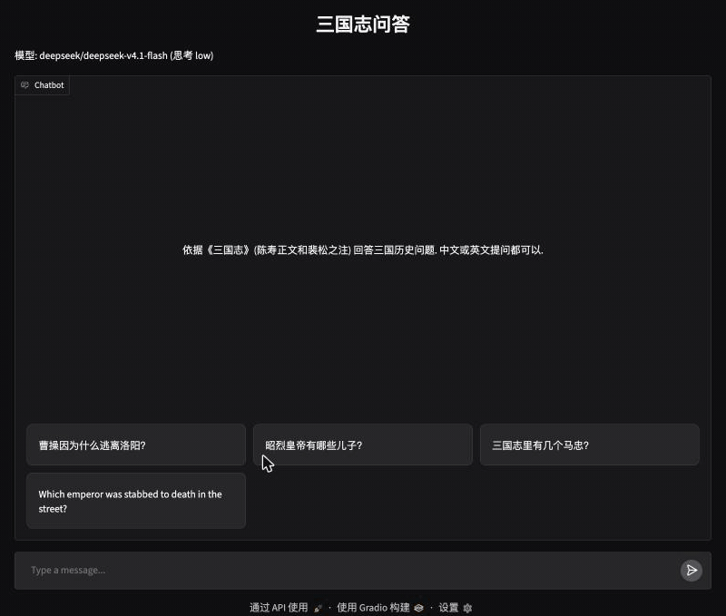

# sanguozhi-rag

[English](README.md) | 中文

[](https://github.com/DynHelium/sanguozhi-rag/actions/workflows/tests.yml)
[](https://huggingface.co/spaces/helium-hf/sanguozhi-rag)

用中文或英文问三国历史，回答依据陈寿《三国志》和裴松之注。agent 先自己检索原文再作答，引用文言原文并标 `[n]` 出处，
代码逐字核对每一处引文。

仓库包含完整的流程：原文解析和切块、用于检索的全书白话译文、混合检索、agent、网页聊天、两个历史游戏，以及评测。

**在线试用：** [huggingface.co/spaces/helium-hf/sanguozhi-rag](https://huggingface.co/spaces/helium-hf/sanguozhi-rag)
（Claude Haiku 5.5）。演示页每天有花费上限；一段时间没人访问会休眠，之后第一次打开要等两分钟左右。



## 功能

- **依据原文回答。** agent 用四个工具自己决定查什么、读什么：`search`（检索）、`read`（读前后文；读裴注时附上它注的正文）、
  `who`（一个名字或称号指谁、有几个同名的人）、`era`（年号第几年换算成公元年）。
- **用白话检索，引原文。** 提问是白话或英文，原文是文言。检索在全书白话译文上做，结合 BM25、向量（bge-m3）和别名扩展
  （问"曹操"也能找到写"太祖""曹公"的段落）。模型同时看到原文和白话，但只引原文。
- **代码核对引文。** 回答里「」中的每一处引文，都在模型看过的段落里逐字核对，后面的 `[n]` 也核对是否指向含有这段文字的那一块。
- **两种大模型后端。** DeepSeek V4.1 Flash（经 OpenRouter，默认）或 Claude Haiku 5.5（Claude 原生接口），在 `.env` 里选。
- **游戏。** 三国海龟汤（谜题取自原文的推理游戏）和猜人物（你猜程序选的人，或者让 agent 猜你想的人），都在聊天里玩；
  谜底只在代码里，另开的裁判看着出处原文作答。

## 快速开始

需要 [uv](https://docs.astral.sh/uv/) 和 Python ≥ 3.11。下载原文和向量模型要联网；提问会经 OpenRouter 或 Claude API 调用模型，
费用记在你的 key 上。

```bash
git clone https://github.com/DynHelium/sanguozhi-rag.git && cd sanguozhi-rag
uv sync --extra index --extra ui
uv run python -m ingest.use_wikisource      # 按固定版本下载带标点的原文, 解析, 切块
uv run python -m ingest.trans_chunks        # 每块配上白话译文
uv run python -m rag.dense --trans          # 用 bge-m3 给白话切块编码 (下载约 2.3 GB, 约 7 分钟)

cp .env.example .env                        # 在 LLM_API_KEY 填 OpenRouter 的 key
uv run python -m app.chat --model deepseek-v4.1-flash --effort low   # 打开 http://localhost:7860
```

命令行问一题：

```bash
uv run python -m rag.agent "桃园结义是真的吗？" --model deepseek-v4.1-flash --effort low
```

用 Claude Haiku 5.5：`uv sync --extra anthropic`，在 `.env` 里设 `LLM_BACKEND=anthropic`、`LLM_MODEL=claude-haiku-5-5`、
`LLM_REASONING_EFFORT=medium` 和 `ANTHROPIC_API_KEY`（`.env.example` 里有这几行）。

只试检索，不用大模型也不用向量模型：

```bash
uv sync && uv run python -m ingest.use_wikisource
uv run python -m rag.retrieve "关羽刮骨疗毒" --bm25
```

测试不调大模型：`uv run python -m tests`。GitHub Actions 在 Linux、macOS、Windows 上跑同一套测试。

## 工作原理

```mermaid
flowchart TB
    subgraph data["数据（离线）"]
        W["维基文库原文<br/>（固定版本）"] --> P["解析：段落<br/>+ 裴注"]
        P --> C["切块"]
        T["白话译文"] --> TC["白话检索块<br/>（与原文对齐）"]
        C --> TC
    end
    subgraph retrieval["检索"]
        B["BM25"] --> F["RRF 融合"]
        D["向量（bge-m3）"] --> F
        E["别名扩展"] --> F
    end
    subgraph agent["Agent"]
        Q["问题"] --> L["agent 循环<br/>DeepSeek V4.1 Flash<br/>或 Claude Haiku 5.5"]
        L --> R["自查 +<br/>引文核对"]
        R --> O["带引文和出处 [n]<br/>的回答"]
    end
    TC --> B
    TC --> D
    L -- "search / read<br/>era / who" --> F
    F -- "原文 + 白话 [n]" --> L
```



agent 循环调用模型，执行它要的工具，把结果交回去，直到它作答；最后一次请求不带工具，轮数上限由此保证。循环之外，
代码在模型搜得太少就作答、或者说原文没有记载时要求它再查一次，作答后让它自查一遍，并核对引文。代码给模型的指令用
`developer` 消息发送（Claude 接口里是 system 消息），不冒充用户。设计取舍和理由见 [docs/DESIGN.md](docs/DESIGN.md)。

## 评测

**检索。** 48 道标了 gold 段落的检索题；hit@k 是答案所在的块是否在前 k 名（宽松口径：挂在它上面的裴注也算）。

| 检索方式 | hit@1 | hit@5 | hit@10 | MRR |
|---|---|---|---|---|
| BM25，搜原文 | 0.25 | 0.31 | 0.40 | 0.28 |
| BM25 + 向量 + 别名扩展，搜原文 | 0.31 | 0.60 | 0.69 | 0.43 |
| BM25 + 向量 + 别名扩展，搜白话（agent 用的） | 0.52 | 0.67 | 0.81 | 0.59 |

37 道留出题上，agent 用的检索 hit@10 为 0.97（搜原文的 BM25 为 0.78）。

**检索对回答的帮助。** 50 道题，每题中英文各问一次，每个模型分五组回答。前四组共用一份最小的 prompt（以《三国志》为准、
直接陈述事实、不确定就说不确定），只差给模型什么资料；最后一组是网页聊天用的配置：

| 组 | DeepSeek 中文 | DeepSeek 英文 | Haiku 中文 | Haiku 英文 |
|---|---|---|---|---|
| 闭卷（不给工具和资料） | 41 | 43 | 22 | 27 |
| 用问题检索一次，前 10 段放进上下文 | 47 | 41 | 43 | 32 |
| 直接给出 gold 原文（上限） | 50 | 49 | 49 | 43 |
| 只给工具，没有代码介入 | 44 | 44 | 41 | 40 |
| **网页上用的配置**（完整 prompt 和代码介入） | **49** | **50** | **47** | **44** |

数字是 50 题里完全正确的题数。网页上用的配置在四列上都比闭卷好（按题配对 bootstrap 的 95% 置信区间不含 0）。
Haiku 提升最多：闭卷时中英文各错 15 题，100 份回答里有 23 份编造或张冠李戴了引文、出处。用英文原问题检索一次帮助不大，
因为索引是中文的；agent 会先把人名和术语译回中文再搜。

判卷只看回答陈述的事实对不对：每题在跑之前写好事实清单（要答到的要点和常见错误，第一轮判卷后改过一次标注），编造的引文或记载、和原文矛盾的事实
会降低判定。评委是大模型（Claude Sonnet），可以检索原文核对。方法、完整结果和逐题判决见 [docs/EVALUATION.md](docs/EVALUATION.md)
和 [`eval-judging`](https://github.com/DynHelium/sanguozhi-rag/tree/eval-judging) 分支。

## 目录结构

| 路径 | 内容 |
|---|---|
| `ingest/` | 下载和解析维基文库原文、白话检索块、年号表 |
| `rag/` | 切块、BM25、向量检索、融合、别名、工具（`library.py`）、agent 循环和 agent、大模型后端、游戏 |
| `app/` | Gradio 网页聊天（`chat.py`）和单独的海龟汤页面（`soup.py`） |
| `skills/` | 聊天里的游戏说明（`SKILL.md`） |
| `eval/` | 检索和回答的评测脚本、题集 |
| `data/` | 白文、白话译文、别名表和年号表、海龟汤题库 |
| `tests/` | 单元测试（不联网、不调大模型） |
| `docs/` | 设计说明、评测、部署 |

## 局限

- 回答只依据《三国志》和裴注，其他史书和后世研究不在范围内。范围由 prompt 要求，代码不强制。
- 白话译文由大模型翻译，只对照原文校对过，会有错误。它只用于检索和帮助模型读懂原文，回答里的引文一律用原文。
- 引文核对只能证明"这段话原文里有、编号对"，不能保证转述和解读正确。
- 评测规模小（50 题，每组跑一遍），判卷是大模型；几题之差在误差之内。

## 数据和授权

- 仓库里的全书原文是**白文**（`data/sources/sanguozhi/baiwen.jsonl`，去掉了标点）。《三国志》正文和裴注属于公有领域，但维基文库录入的
  断句标点沿用中华书局点校本，所以 `ingest.use_wikisource` 改为按固定版本从维基文库下载带标点的原文。
- 代码：MIT（[LICENSE](LICENSE)）。`data/` 下的数据、题集和评测结果：CC BY-SA 4.0（[LICENSE-DATA](LICENSE-DATA) 列出了具体文件和来源）。

## 致谢

原文来自[维基文库](https://zh.wikisource.org/wiki/三國志)。检索用了北京智源研究院的 [bge-m3](https://huggingface.co/BAAI/bge-m3)，
网页聊天基于 [Gradio](https://www.gradio.app/)。
